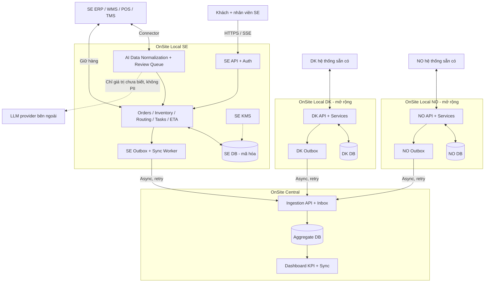
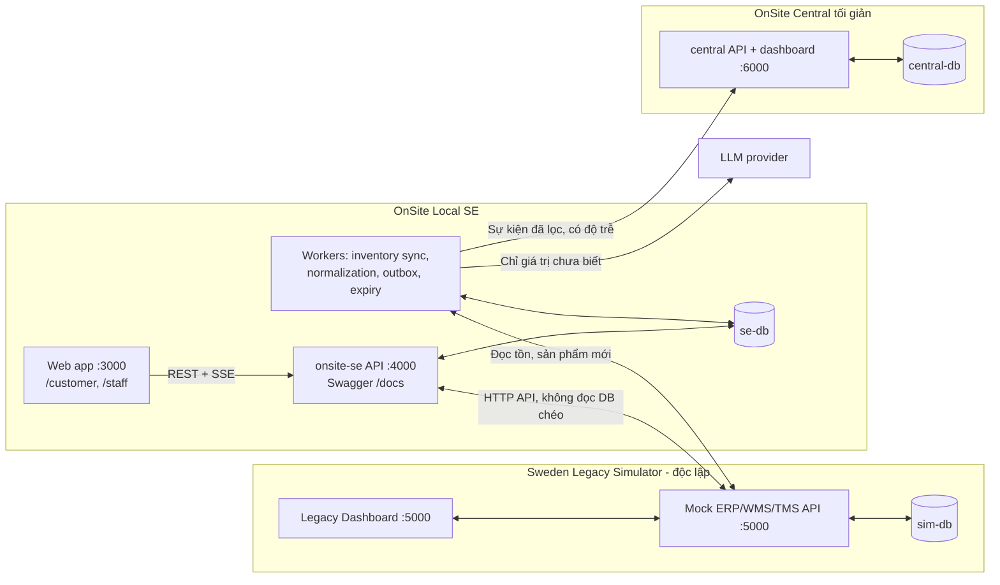
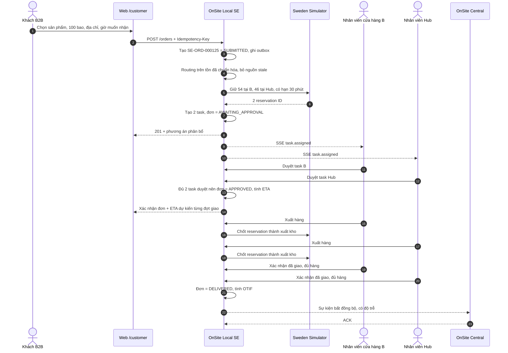
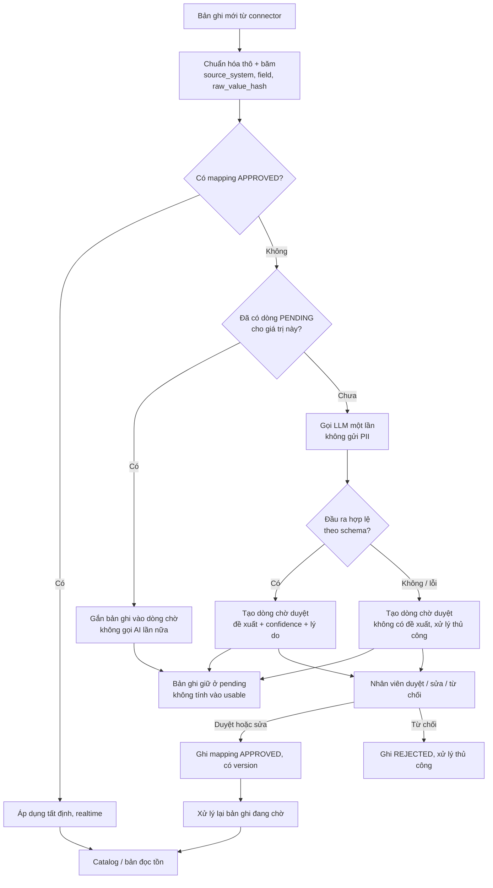
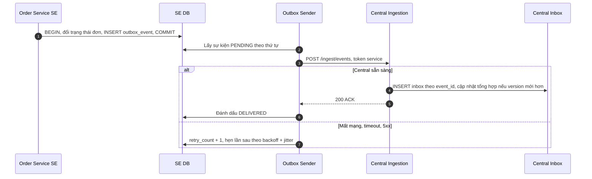

# BÁO CÁO KIẾN TRÚC HỆ THỐNG VÀ KẾ HOẠCH XÂY DỰNG MVP — ONSITE

**Đội thực hiện:** PYRAMID
**Tên giải pháp:** OnSite — Integration Middleware & Order Fulfilment Orchestration
**Bối cảnh:** Netcompany × Code MeLy — IT Consultant Challenge 2026, Round 2 (Build-a-thon)
**Phiên bản tài liệu:** 3.0 — 04/11/2026 (thay thế các bản 1.0, 2.0, 2.1 và bản kế hoạch MVP 1.0)
**Phạm vi chính:** Sweden (SE); thiết kế mở rộng: Denmark (DK), Norway (NO)
**Trạng thái:** Kiến trúc đề xuất và kế hoạch triển khai. Mọi thành phần được gắn nhãn **[MVP]** (sẽ chạy thật trong bản demo), **[MÔ PHỎNG]** (chạy thật nhưng trên dữ liệu/hệ thống giả lập) hoặc **[THIẾT KẾ]** (chưa hiện thực trong vòng 2).

> **Luận điểm của OnSite:** Bốn thách thức của Company A cùng xuất phát từ một khoảng trống thông tin: không ai nhìn thấy đơn hàng từ đầu đến cuối. OnSite đặt một lớp API và điều phối lên trên các hệ thống sẵn có (ERP/WMS/POS/TMS), **không thay ERP**. Mỗi quốc gia có một **OnSite Local** riêng (API, database, khóa mã hóa, connector) tự xử lý đơn nội địa; **OnSite Central** chỉ tổng hợp và giám sát. AI có **một vai trò duy nhất**: chuẩn hóa dữ liệu đi vào từ các hệ thống nguồn theo mô hình *AI đề xuất realtime → người duyệt một lần → áp dụng tự động, tất định*. Đồng bộ là **gần thời gian thực, có độ trễ và đo được độ trễ**.

---

## MỤC LỤC

0. Tóm tắt điều hành
1. Bối cảnh, bài toán và những gì thay đổi so với vòng 1
2. Bản đồ năng lực của hệ thống (chi tiết)
3. Nguyên tắc và quyết định kiến trúc
4. Kiến trúc tổng thể và sơ đồ ngữ cảnh
5. Bên trong OnSite Local: Local có API như thế nào
6. Người dùng, phân quyền và cách cửa hàng kết nối
7. Luồng đơn hàng B2B từ đầu đến cuối
8. Tồn kho, định tuyến và giữ hàng
9. AI chuẩn hóa dữ liệu realtime có hàng chờ duyệt
10. Đồng bộ Local ↔ Central gần thời gian thực
11. Thiết kế dữ liệu
12. Hợp đồng API
13. Bảo mật và mã hóa theo quốc gia
14. Môi trường Thụy Điển giả lập (Sweden Legacy Simulator)
15. Chỉ số đo lường và phương pháp Before/After
16. Rủi ro và kiểm soát
17. Kiểm thử bắt buộc
18. Kế hoạch triển khai đến hạn nộp
19. Kịch bản demo và video 7 phút
20. Gói nộp cho Ban tổ chức
21. Lộ trình mở rộng sau vòng 2
22. Ranh giới khẳng định khi trình bày
Phụ lục A–D

---

## 0. TÓM TẮT ĐIỀU HÀNH

| Câu hỏi | Trả lời ngắn |
|---|---|
| **Vấn đề gì?** | Đơn B2B giao trễ/thiếu; thiếu hàng chỉ lộ ra lúc bốc xe; khách phải gọi điện hỏi trạng thái; mỗi nước, mỗi hệ thống một cách ghi dữ liệu. Thụy Điển đau nhất ở khâu giao hàng. |
| **Gốc rễ?** | Không có dòng trạng thái đơn hàng và tồn kho dùng chung giữa cửa hàng, hub và vận chuyển. |
| **OnSite làm gì?** | Kết nối hệ thống cũ qua API; chuẩn hóa dữ liệu; kiểm tra tồn khả dụng ngay khi nhận đơn; chọn và tách nguồn xuất hàng; giữ hàng nguyên tử; giao việc cho từng điểm xuất; tính ETA và cảnh báo trễ; đồng bộ sự kiện lên Central. |
| **Không làm gì?** | Không thay ERP/WMS/POS, không làm kế toán, không phát hành hóa đơn thuế, không xử lý thanh toán thật. |
| **AI ở đâu?** | Chỉ ở khâu chuẩn hóa dữ liệu nguồn. AI xử lý realtime giá trị mới, nhưng chỉ tạo đề xuất chờ duyệt; giá trị đã duyệt không gọi lại AI. |
| **MVP vòng 2 gồm gì?** | Sweden Legacy Simulator độc lập (10 cửa hàng A–J + 1 hub) + OnSite Local SE chạy thật có API/DB riêng + giao diện khách và nhân viên + AI chuẩn hóa có hàng chờ duyệt + Central tối giản đo độ trễ đồng bộ. |
| **Chạy ở đâu?** | Local bằng Docker Compose (đề cho phép chạy local). |
| **Hạn nộp** | 22:00 (GMT+7) ngày 09/11/2026; mục tiêu nội bộ nộp trước 18:00 cùng ngày. |

---

## 1. BỐI CẢNH, BÀI TOÁN VÀ NHỮNG GÌ THAY ĐỔI SO VỚI VÒNG 1

### 1.1. Company A theo đề bài

Company A là doanh nghiệp bán lẻ vật liệu xây dựng hàng đầu của Đan Mạch, có hàng trăm cửa hàng tại Đan Mạch, Na Uy và Thụy Điển, phục vụ cả doanh nghiệp xây dựng (B2B) lẫn người tiêu dùng. Mỗi nước và vùng đã tự phát triển hệ thống và quy trình thủ công riêng, dẫn đến bốn thách thức liên quan nhau:

| Thách thức | Thị trường bị ảnh hưởng mạnh nhất (theo đề) | OnSite tác động bằng cách nào |
|---|---|---|
| Manual processes | Denmark | Số hóa nhập/trao đổi đơn, giảm gõ lại; về sau mở module tiếp nhận đơn dạng văn bản |
| Inconsistent operations | Norway | Một quy trình task chuẩn cho mọi cửa hàng: nhận → duyệt → xuất → giao |
| Delivery & fulfilment | **Sweden — trọng tâm MVP** | Kiểm tra tồn ngay lúc đặt, tách đơn nhiều nguồn, giữ hàng, ETA, cảnh báo trễ |
| Fragmented systems | Cả ba nước | Lớp API + chuẩn dữ liệu chung + Central giám sát, không thay ERP |

### 1.2. Bằng chứng và giả định kế thừa từ đề xuất vòng 1 của PYRAMID

- Chỉ 38% chuyến giao đến công trường ở Thụy Điển đến đúng như thỏa thuận (thời gian, số lượng, địa điểm, chứng từ) — nghiên cứu Thunberg & Persson 2014, được trích dẫn trong vòng 1.
- Nguyên nhân số một của giao trễ là giao tiếp kém giữa nhà cung cấp, đơn vị vận chuyển và công trường — nghiên cứu được trích trong vòng 1.
- Kịch bản minh họa vòng 1: site manager email đặt hàng, nhân viên gõ lại; hàng thiếu không hệ thống nào báo; đội thợ chờ không có ETA; gọi điện mất 20 phút mới có câu trả lời.
- **Kế hoạch thí điểm (là mục tiêu, không phải kết quả):** 1 vùng Thụy Điển, 10 cửa hàng + 1 hub, đơn B2B, nhóm SKU bán chạy; KPI go/no-go OTIF +3 điểm phần trăm, cuộc gọi hỏi trạng thái −30%, adoption >90%; safety stock 10%.

### 1.3. Những gì thay đổi so với vòng 1 và lý do

Đề vòng 2 yêu cầu giải thích mọi thay đổi. Đây là bảng dùng chung cho video và tài liệu:

| Vòng 1 đề xuất | Vòng 2 triển khai | Lý do |
|---|---|---|
| Một "Smart Integration Hub" trung tâm chứa AI SKU Harmonizer và Smart Routing | Logic xử lý đơn đặt tại **OnSite Local từng nước**; **Central** chỉ tổng hợp, giám sát | Central không nằm trên đường xử lý đơn nên lỗi mạng xuyên quốc gia không làm dừng đơn nội địa; dữ liệu và quyền ghi được cô lập theo nước |
| "100% cross-market stock visibility", routing có thể xuyên biên giới | **Không routing xuyên biên giới**; mỗi đơn thuộc một nước và chỉ phân bổ trong nước đó | Giao vật liệu nặng xuyên biên giới không thực tế; tránh giao dịch phân tán nhiều nước |
| AI SKU Harmonizer quy mã hàng 3 nước về Global SKU là lõi | AI **chuẩn hóa dữ liệu nguồn** (đơn vị, mô tả, thuộc tính) có hàng chờ duyệt; Global SKU đa quốc gia chuyển sang giai đoạn DK/NO | Trong phạm vi Sweden không có căn cứ rằng các cửa hàng dùng mã khác nhau; nhưng các hệ thống nguồn khác nhau vẫn ghi dữ liệu khác định dạng — đó là chỗ AI có giá trị thật |
| Ngưỡng >95% tự gộp, 70–95% người duyệt | Trong MVP **mọi** đề xuất AI đều qua người duyệt; ngưỡng chỉ xét sau khi có số đo trên tập kiểm thử | Chưa có dữ liệu chứng minh độ chính xác của ngưỡng |
| Safety buffer 10% cố định (slide 7) và động 5–15% (slide 10) | Tham số cấu hình theo `country/store/SKU`, mặc định 10%, công thức làm tròn rõ ràng | Thống nhất một quy tắc, giữ khả năng hiệu chỉnh |
| Prototype giao diện minh họa trên Vercel | Hệ thống chạy thật: API, database, giao dịch, đồng bộ; chạy local bằng Docker Compose | Đề vòng 2 yêu cầu MVP chức năng; cần worker nền và nhiều database |

### 1.4. Giả định của MVP (phải ghi rõ trong video)

1. Không có quyền truy cập ERP/WMS/TMS thật → dùng **Sweden Legacy Simulator** có API và database riêng.
2. Trong Sweden các cửa hàng dùng **chung mã hàng** theo mặc định. Không dựng tình huống giả rằng mỗi cửa hàng một mã.
3. Các hệ thống nguồn ghi dữ liệu **khác định dạng** (đơn vị `st`, `säck`, `pall`, `bag`; mô tả tự do tiếng Thụy Điển; tên trường khác nhau). Simulator mô phỏng điều này ở dữ liệu sản phẩm mới và một nguồn tồn kho.
4. Khoảng cách, tốc độ xe, thời gian chuẩn bị, khung giờ xe chạy là **tham số cấu hình mô phỏng**.
5. AI gọi qua một **LLM provider bên ngoài**; API key chỉ nằm ở server.
6. Số liệu kinh doanh trong demo là số liệu mô phỏng, được gắn nhãn.

---

## 2. BẢN ĐỒ NĂNG LỰC CỦA HỆ THỐNG

Phần này mô tả từng năng lực của OnSite: làm gì, đầu vào, đầu ra, quy tắc, giới hạn và mức hiện thực trong vòng 2.

### 2.0. Tổng quan

| Mã | Năng lực | Người hưởng lợi | Mức vòng 2 |
|---|---|---|---|
| C1 | Kết nối hệ thống nguồn (connector) | Toàn hệ thống | [MVP] với simulator |
| C2 | AI chuẩn hóa dữ liệu realtime có hàng chờ duyệt | Nhân viên dữ liệu, routing | [MVP] |
| C3 | Danh mục sản phẩm và cửa hàng | Khách, nhân viên | [MVP] |
| C4 | Bản đọc tồn kho có độ mới | Routing, khách | [MVP] |
| C5 | Tiếp nhận đơn B2B an toàn khi gửi lại | Khách B2B | [MVP] |
| C6 | Định tuyến và tách đơn tất định, có giải thích | Khách, cửa hàng, hub | [MVP] |
| C7 | Giữ hàng nguyên tử có thời hạn | Cửa hàng, hub | [MVP] trên simulator |
| C8 | Giao việc và duyệt theo từng điểm xuất | Nhân viên cửa hàng/hub | [MVP] |
| C9 | Chứng từ xử lý đơn | Nhân viên, khách | [MVP] |
| C10 | ETA dự kiến và cảnh báo trễ chủ động | Khách, dispatcher | [MVP] với tham số mô phỏng |
| C11 | Theo dõi đơn cho khách và xác nhận đã giao | Khách, tài xế | [MVP] |
| C12 | Thông báo realtime cho nhân viên | Nhân viên | [MVP] |
| C13 | Đồng bộ sự kiện lên Central có retry, chống trùng | Quản lý đa quốc gia | [MVP] tối giản |
| C14 | Dashboard Central: KPI và độ trễ | Quản lý, kỹ thuật | [MVP] tối giản |
| C15 | Phân quyền theo nước và cửa hàng | Toàn hệ thống | [MVP] JWT cơ bản |
| C16 | Mã hóa dữ liệu nhạy cảm theo khóa từng nước | Toàn hệ thống | [MVP] khóa SE qua env; KMS [THIẾT KẾ] |
| C17 | Audit, metrics, health | Kỹ thuật, giám khảo | [MVP] |
| C18 | Chống chịu lỗi: Central offline, nguồn stale, AI lỗi | Toàn hệ thống | [MVP] các kịch bản chính |
| C19 | Nhân bản sang nước mới (DK/NO) | Doanh nghiệp | [THIẾT KẾ]; stretch nếu còn thời gian |

### C1. Kết nối hệ thống nguồn

- **Làm gì:** đọc catalog, tồn kho, giao dịch nhập/xuất từ hệ thống nguồn; gọi giữ hàng, chốt xuất, hủy giữ hàng khi nguồn hỗ trợ.
- **Cách kết nối:** HTTP API của simulator. Production hỗ trợ ba kiểu: webhook/REST (hệ thống hiện đại), poller đọc delta qua SQL view chỉ đọc hoặc SFTP micro-batch (hệ thống cũ), và gọi ghi chỉ khi nguồn có API giữ hàng.
- **Quy tắc:** connector chỉ ghi phần dữ liệu thuộc nguồn của mình; mỗi bản ghi mang `source_system`, `source_event_id` hoặc cursor, `source_updated_at`, `ingested_at`; chống trùng bằng inbox unique.
- **Không làm:** không sửa code ERP, không đọc thẳng database của simulator, không tự coi đã giữ hàng khi nguồn chỉ cho đọc.

### C2. AI chuẩn hóa dữ liệu realtime có hàng chờ duyệt

- **Làm gì:** đưa dữ liệu nguồn khác định dạng về schema chuẩn của OnSite (danh mục sản phẩm, đơn vị cơ sở, bí danh đơn vị, thuộc tính).
- **Cơ chế:** giá trị đã duyệt → tra bảng, áp dụng ngay, không gọi AI; giá trị mới → gọi AI một lần → tạo một dòng chờ duyệt → nhân viên duyệt/sửa/từ chối → mapping `APPROVED` → xử lý lại các bản ghi đang chờ.
- **Bảo vệ:** bản ghi chưa duyệt không được tính vào tồn khả dụng; đầu ra AI bị ràng buộc vào danh sách giá trị hợp lệ; không gửi PII; hệ số quy đổi đơn vị không do AI đoán.
- Chi tiết ở mục 9.

### C3. Danh mục sản phẩm và cửa hàng

- 10 cửa hàng A–J + Hub SE-01 với vị trí, giờ phục vụ, năng lực chuẩn bị, trạng thái.
- Sản phẩm có SKU chính thức, nhóm hàng, đơn vị cơ sở, `pack_size_verified`, trạng thái (`ACTIVE`, `PENDING_REVIEW`).
- Khách chỉ thấy sản phẩm `ACTIVE`; sản phẩm mới chỉ hiện sau khi chuẩn hóa được duyệt.

### C4. Bản đọc tồn kho có độ mới

- Lưu theo `node_id × sku_id`: `on_hand`, `reserved`, `source_updated_at`, `ingested_at`, `version`.
- Tính `usable` theo công thức ở mục 8.1; hiển thị cho khách là "có thể đáp ứng" kèm thời điểm cập nhật, không hiển thị con số tuyệt đối nếu không cần.
- Đánh dấu `STALE` khi tuổi dữ liệu vượt ngưỡng; dữ liệu stale không dùng để cam kết.

### C5. Tiếp nhận đơn B2B

- Khách chọn cửa hàng đầu mối, sản phẩm, số lượng, địa chỉ công trình, thời điểm muốn nhận.
- `Idempotency-Key` bắt buộc: gửi lại cùng key và cùng nội dung trả lại cùng kết quả; cùng key khác nội dung trả `409`.
- Mã đơn sinh **ngay khi tiếp nhận**, dạng `SE-ORD-000125`.

### C6. Định tuyến và tách đơn

- Hàm thuần, tất định: cùng đầu vào cho cùng kết quả, dễ kiểm thử.
- Ưu tiên một nguồn đủ hàng gần nhất; nếu không có, tách tối thiểu số nguồn; mỗi phương án kèm `routing_reason` có thể đọc được.
- Không đủ hàng sau buffer → không cam kết, chuyển `NEEDS_REVIEW` với phương án thay thế (giao một phần, nguồn khác, ngày khác).

### C7. Giữ hàng nguyên tử có thời hạn

- Giữ hàng tại **nguồn có thẩm quyền** (simulator) bằng câu lệnh cập nhật có điều kiện; hai đơn tranh cùng lượng hàng cuối thì chỉ một đơn thắng.
- Mỗi lần giữ có `expires_at` (mặc định 30 phút trong demo). Hết hạn mà chưa duyệt thì tự nhả.
- Tách nhiều nguồn là một **saga**: một nguồn thất bại thì nhả các nguồn đã giữ.

### C8. Giao việc và duyệt theo từng điểm xuất

- Mỗi nguồn xuất hàng nhận một **fulfilment task** riêng.
- Nhân viên chỉ thấy và thao tác task thuộc `store_id` của mình.
- Đơn chỉ `APPROVED` khi **mọi** task đã duyệt; một task bị từ chối thì đơn chuyển `NEEDS_REALLOCATION` và hệ thống thử nguồn khác.

### C9. Chứng từ xử lý đơn

| Chứng từ | Khi nào | Nội dung chính |
|---|---|---|
| Xác nhận tiếp nhận | Ngay khi tạo đơn | Mã đơn, nội dung, "đang kiểm tra" — chưa cam kết |
| Phiếu xử lý / phiếu lấy hàng | Sau phân bổ, **mỗi điểm xuất một phiếu** | Mã đơn, mã task, khách, cửa hàng đầu mối, điểm xuất, SKU, số lượng, địa chỉ, thời điểm muốn nhận, người phụ trách |
| Xác nhận đơn cho khách | Khi đơn `APPROVED` | Nội dung đã xác nhận, các đợt giao, ETA **dự kiến** |
| Hóa đơn thuế | — | **Ngoài phạm vi**; chỉ phát hành qua hệ thống kế toán hợp lệ |

### C10. ETA dự kiến và cảnh báo trễ chủ động

- ETA tính theo quy tắc minh bạch ở mục 7.5, gắn nhãn "dự kiến".
- Nếu ETA muộn hơn thời điểm khách muốn nhận → đánh dấu `AT_RISK`, báo ngay cho khách và nhân viên **trước khi** khách phải gọi hỏi.
- Đây là năng lực trực tiếp nhắm vào KPI giảm cuộc gọi hỏi trạng thái của vòng 1.

### C11. Theo dõi đơn và xác nhận đã giao

- Trang theo dõi cho khách: trạng thái từng đợt giao, ETA, lịch sử thay đổi.
- Xác nhận giao (proof of delivery) ở giao diện nhân viên: giao đủ hay thiếu, ghi chú, thời điểm. Có dữ liệu này mới đo được OTIF.

### C12. Thông báo realtime cho nhân viên

- Server-Sent Events (SSE): báo "có task mới", "task thay đổi".
- SSE chỉ là tín hiệu; dữ liệu chuẩn luôn đọc qua REST từ database. Mất kết nối thì tải lại bằng REST.

### C13. Đồng bộ sự kiện lên Central

- Transactional outbox: thay đổi nghiệp vụ và sự kiện ghi trong cùng transaction.
- Worker gửi theo kiểu at-least-once; Central chống trùng theo `event_id`; Central offline thì sự kiện chờ và gửi bù.

### C14. Dashboard Central

- KPI: số đơn theo trạng thái, đơn `AT_RISK`, số đơn phát hiện thiếu hàng ngay lúc đặt, OTIF mô phỏng.
- Kỹ thuật: độ trễ Local → Central, số sự kiện chờ, lần nhận cuối, trạng thái Online/Delayed/Offline.

### C15. Phân quyền

- Vai trò: `customer`, `staff`, `admin`, `connector`, `service`.
- Quyền kiểm tra ở backend theo `country + store_id + chủ sở hữu tài nguyên`; client không tự cấp quyền bằng cách sửa `store_id`.

### C16. Mã hóa theo quốc gia

- Trường nhạy cảm (liên hệ, địa chỉ công trình) mã hóa AES-256-GCM ở tầng ứng dụng với **khóa riêng của SE**.
- Central không có khóa giải mã của Local. Production dùng KMS và envelope encryption theo nước.

### C17. Audit, metrics, health

- `GET /health` (tình trạng DB, simulator, Central), `GET /metrics` (độ trễ, số liệu AI, số liệu đơn).
- Audit mọi thao tác thay đổi: ai, việc gì, kết quả, thời điểm; không ghi token hoặc PII thô.
- Swagger tại `/docs` để kiểm tra API thật.

### C18. Chống chịu lỗi

| Sự cố | Hành vi |
|---|---|
| Central offline | Local vẫn nhận và xử lý đơn; outbox tích lũy; gửi bù không trùng |
| Simulator/ERP mất kết nối | Tồn kho bị đánh dấu stale; không hứa giữ hàng; đơn chuyển `NEEDS_REVIEW` |
| AI lỗi hoặc timeout | Bản ghi giữ ở hàng chờ để xử lý thủ công; dữ liệu đã duyệt vẫn chạy |
| Hai đơn tranh cùng hàng | Một đơn giữ được, đơn còn lại được tính lại hoặc báo thiếu |
| Gửi lại request do timeout | Không sinh đơn trùng |
| Nhân viên không duyệt | Giữ hàng hết hạn và tự nhả |

### C19. Nhân bản sang nước mới

- Cùng codebase, chạy thêm một instance với `COUNTRY_CODE`, database, khóa, connector riêng.
- Module nghiệp vụ bật theo nhu cầu từng nước: DK ưu tiên số hóa đầu vào đơn thủ công, NO ưu tiên vận hành cửa hàng.

---

## 3. NGUYÊN TẮC VÀ QUYẾT ĐỊNH KIẾN TRÚC

| Mã | Quyết định | Lý do |
|---|---|---|
| ADR-01 | Mỗi nước một OnSite Local độc lập | Giảm đường đi xuyên quốc gia, cô lập lỗi, tách dữ liệu và quyền |
| ADR-02 | Central không nằm trên đường xử lý đơn nội địa | Central lỗi không làm dừng nhận đơn |
| ADR-03 | Mỗi loại dữ liệu có đúng một chủ thể có quyền ghi | Tránh ghi đè chồng chéo |
| ADR-04 | Đồng bộ Local–Central bất đồng bộ qua outbox | Chịu được trễ, retry, mất mạng; đo được độ trễ |
| ADR-05 | Cùng thuật toán mã hóa chuẩn, khác khóa và quyền theo nước | An toàn kiểm chứng được, giới hạn phạm vi sự cố |
| ADR-06 | ERP/WMS/POS (simulator trong MVP) là nguồn tồn kho thật | Không tạo ERP thứ hai |
| ADR-07 | AI chỉ chuẩn hóa dữ liệu, mọi đề xuất qua người duyệt | Dùng AI đúng chỗ có giá trị, kiểm soát được rủi ro |
| ADR-08 | Duyệt theo từng điểm xuất hàng | Xác nhận của cửa hàng B không thay cho hub |
| ADR-09 | API-first, giao diện chỉ là client của API | Phục vụ web, hệ thống ngoài và kiểm thử như nhau |
| ADR-10 | Local là modular monolith | Hoàn thành nhanh, ít lỗi phân tán, vẫn tách module rõ |
| ADR-11 | Routing là hàm thuần tất định | Kiểm thử được, giải thích được, không phụ thuộc AI |

---

## 4. KIẾN TRÚC TỔNG THỂ VÀ SƠ ĐỒ NGỮ CẢNH

### 4.1. Kiến trúc đích (production)



### 4.2. Kiến trúc MVP vòng 2 (chạy bằng Docker Compose)



**Quy tắc bắt buộc của topology MVP:**

1. Ba database tách riêng: `sim-db`, `se-db`, `central-db`, mỗi cái một user/mật khẩu riêng. Không ứng dụng nào đọc database của ứng dụng khác.
2. Simulator chạy được khi OnSite tắt.
3. OnSite Local SE chạy được khi Central tắt.
4. Mọi giao tiếp giữa ba hệ thống là HTTP API.

### 4.3. Sơ đồ ngữ cảnh: bên trong và bên ngoài hệ thống

| Thực thể bên ngoài | Tương tác với OnSite Local SE | Giao thức |
|---|---|---|
| Khách B2B (site manager, công ty xây dựng) | Xem sản phẩm, đặt đơn, theo dõi đơn, nhận cảnh báo trễ | HTTPS REST qua web |
| Nhân viên cửa hàng A–J và hub | Nhận task, duyệt/từ chối, xuất hàng, xác nhận giao, duyệt đề xuất AI | HTTPS REST + SSE qua web |
| Sweden ERP/WMS/TMS (simulator trong MVP) | Cung cấp catalog, tồn, sản phẩm mới; nhận lệnh giữ/chốt/hủy giữ hàng | HTTP API có xác thực service |
| LLM provider | Nhận giá trị dữ liệu chưa biết, trả đề xuất chuẩn hóa | HTTPS, API key ở server |
| OnSite Central | Nhận sự kiện đã lọc, trả ACK | HTTPS, token service |
| Quản lý vận hành đa quốc gia | Xem dashboard Central | HTTPS |

---

## 5. BÊN TRONG ONSITE LOCAL: LOCAL CÓ API NHƯ THẾ NÀO

### 5.1. Khái niệm

OnSite Local SE là **một chương trình backend chạy liên tục, mở cổng HTTP** (`:4000` trong MVP). Mọi thành phần khác — giao diện khách, giao diện nhân viên, worker, Central — chỉ làm việc với nó qua request HTTP. Local có database riêng; không ai được truy cập trực tiếp database đó.

"Local" là phạm vi triển khai theo quốc gia, **không** phải máy chủ đặt trong từng cửa hàng. Một Local SE phục vụ cả 10 cửa hàng và hub.

### 5.2. Cấu trúc module (modular monolith)

```text
apps/onsite-local-se/
├── src/
│   ├── server.ts              # Khởi tạo Fastify, đăng ký module, mở cổng
│   ├── config.ts              # Đọc biến môi trường: COUNTRY_CODE, DATABASE_URL, khóa...
│   ├── db.ts                  # Pool Postgres, helper transaction
│   ├── auth.ts                # Kiểm tra JWT, gắn role, country, store_id
│   ├── modules/
│   │   ├── catalog/           # Cửa hàng, sản phẩm
│   │   ├── inventory/         # Bản đọc tồn, tính usable, freshness
│   │   ├── normalization/     # AI chuẩn hóa + hàng chờ duyệt
│   │   ├── orders/            # Tiếp nhận, idempotency, state machine
│   │   ├── routing/           # Hàm thuần chọn nguồn, tách đơn
│   │   ├── reservations/      # Saga giữ hàng qua connector, hết hạn
│   │   ├── tasks/             # Task theo điểm xuất: duyệt, xuất, giao
│   │   ├── eta/               # Tính ETA, cảnh báo AT_RISK
│   │   ├── documents/         # Phiếu xử lý, xác nhận đơn
│   │   ├── notifications/     # SSE theo scope
│   │   ├── sync/              # Outbox worker → Central
│   │   └── metrics/           # /health, /metrics, audit
│   └── connectors/
│       ├── simulator.ts       # Client HTTP tới simulator
│       └── llm.ts             # Client tới LLM provider, đầu ra có schema
├── migrations/                # SQL tạo bảng, ràng buộc
├── test/                      # Unit (routing, state machine), integration, concurrency
└── Dockerfile
```

Mỗi module có ba lớp: **route** (nhận HTTP, kiểm tra input theo schema), **service** (logic nghiệp vụ, transaction), **repository** (câu SQL). Route không chứa logic nghiệp vụ, nên logic kiểm thử được mà không cần HTTP.

### 5.3. Đường đi của một request `POST /api/v1/orders`

1. **Route:** kiểm tra JWT (vai trò `customer`), kiểm tra body theo schema, đọc `Idempotency-Key`.
2. **Idempotency:** tìm key trong `idempotency_records`. Đã có và cùng nội dung → trả lại kết quả cũ. Cùng key khác nội dung → `409`.
3. **Tạo đơn:** transaction ghi `orders` (trạng thái `SUBMITTED`), `order_items`, `order_events`, `outbox_events`.
4. **Routing:** đọc bản tồn mới nhất, bỏ nguồn stale, chạy hàm định tuyến (mục 8.3) → phương án phân bổ.
5. **Giữ hàng:** gọi simulator giữ hàng từng nguồn. Một nguồn trả `409 không đủ hàng` → nhả các nguồn đã giữ, tính lại với tồn mới; thử tối đa 2 lần.
6. **Ghi kết quả:** transaction ghi `allocations`, `reservations`, `fulfilment_tasks`, cập nhật đơn sang `AWAITING_APPROVAL`, ghi outbox.
7. **Phản hồi:** `201` kèm mã đơn, trạng thái, phương án phân bổ, `inventory_as_of`.
8. **Thông báo:** phát SSE tới nhân viên của từng điểm xuất.

### 5.4. Worker nền chạy trong Local

| Worker | Chu kỳ (MVP, cấu hình được) | Nhiệm vụ |
|---|---|---|
| Inventory sync | 10 giây | Lấy delta tồn từ simulator theo cursor, cập nhật bản đọc, đánh dấu stale |
| Product sync | 10 giây | Lấy sản phẩm mới, đưa qua chuẩn hóa |
| Normalization | Khi có bản ghi mới | Tra mapping, gọi AI cho giá trị chưa biết, tạo dòng chờ duyệt, xử lý lại bản ghi sau khi duyệt |
| Reservation expiry | 30 giây | Nhả giữ hàng quá hạn, cập nhật đơn sang `EXPIRED` |
| ETA watcher | 60 giây | Tính lại ETA, đánh dấu `AT_RISK`, gửi cảnh báo |
| Outbox sender | 2 giây | Gửi sự kiện chưa ACK lên Central, retry có backoff |

### 5.5. Kiểm chứng "API là thật"

- `GET /api/v1/health` trả trạng thái DB, simulator, Central.
- Swagger UI tại `/docs` liệt kê mọi endpoint, gọi thử được.
- Bộ test integration gọi tuần tự toàn bộ luồng đơn hàng.
- Log có `request_id` cho từng request, mở được khi quay video.

---

## 6. NGƯỜI DÙNG, PHÂN QUYỀN VÀ CÁCH CỬA HÀNG KẾT NỐI

### 6.1. Vai trò

| Vai trò | Ví dụ | Được làm | Không được làm |
|---|---|---|---|
| `customer` | Site manager của công ty xây dựng | Xem sản phẩm, đặt đơn, xem đơn của mình | Xem đơn của khách khác |
| `staff` | Nhân viên cửa hàng B, nhân viên Hub SE-01 | Xem/duyệt/xuất/giao task của điểm mình; duyệt đề xuất AI | Thao tác task của điểm khác |
| `admin` | Quản lý vùng | Xem mọi đơn trong SE, cấu hình tham số | Ghi dữ liệu nước khác |
| `connector` | Tài khoản dịch vụ của simulator | Gửi sự kiện tồn/sản phẩm | Gọi API của khách/nhân viên |
| `service` | Sync worker gửi Central | Gửi sự kiện tới Central | Đọc dữ liệu khách |

### 6.2. Cửa hàng B kết nối thế nào

1. Nhân viên cửa hàng B mở web `/staff` và đăng nhập. Trình duyệt **chủ động kết nối ra** Local SE qua HTTPS.
2. Local SE cấp token gắn `country=SE`, `role=staff`, `store_id=SE-STORE-B`.
3. Web mở kết nối SSE `GET /api/v1/stream`. Khi có task cho B, server phát sự kiện `task.assigned`.
4. Web gọi `GET /api/v1/staff/tasks?status=PENDING_APPROVAL` để lấy dữ liệu thật.
5. Nhân viên bấm duyệt → `POST /api/v1/staff/tasks/{taskId}/approve` kèm `version`.

Cửa hàng **không cần IP public, không cần mở cổng vào**. `POST` là phương thức HTTP, không phải cách định tuyến tới máy của cửa hàng.

---

## 7. LUỒNG ĐƠN HÀNG B2B TỪ ĐẦU ĐẾN CUỐI

### 7.1. Sơ đồ tuần tự



### 7.2. Trạng thái đơn hàng

```text
SUBMITTED ──> ALLOCATING ──┬──> AWAITING_APPROVAL ──> APPROVED ──> DISPATCHING ──> DISPATCHED ──> DELIVERED
                           │            │
                           │            ├──> NEEDS_REALLOCATION ──> ALLOCATING  (một task bị từ chối)
                           │            └──> EXPIRED                           (giữ hàng quá hạn)
                           └──> NEEDS_REVIEW  (không đủ hàng sau buffer / nguồn stale / nguồn lỗi)

CANCELLED: từ SUBMITTED, ALLOCATING, AWAITING_APPROVAL, NEEDS_REVIEW, NEEDS_REALLOCATION (nhả mọi giữ hàng)
```

| Trạng thái | Ý nghĩa | Điều kiện vào |
|---|---|---|
| `SUBMITTED` | Đã tiếp nhận, chưa cam kết | Request hợp lệ |
| `ALLOCATING` | Đang chọn nguồn và giữ hàng | Ngay sau tiếp nhận hoặc sau từ chối |
| `AWAITING_APPROVAL` | Đã giữ hàng ở mọi nguồn, chờ các điểm duyệt | Mọi reservation thành công |
| `NEEDS_REVIEW` | Không cam kết được | Thiếu hàng sau buffer, nguồn stale, hoặc nguồn lỗi |
| `NEEDS_REALLOCATION` | Một điểm từ chối, cần tìm nguồn khác | Một task `REJECTED` |
| `APPROVED` | Đơn đã xác nhận với khách | **Mọi** task `APPROVED` |
| `DISPATCHING` | Một phần đã xuất | Ít nhất một task `DISPATCHED` |
| `DISPATCHED` | Mọi phần đã xuất | Mọi task `DISPATCHED` |
| `DELIVERED` | Đã giao | Mọi task `DELIVERED` có xác nhận giao |
| `EXPIRED` | Giữ hàng hết hạn khi chưa duyệt | Worker hết hạn |
| `CANCELLED` | Khách hoặc admin hủy | Trạng thái cho phép hủy |

### 7.3. Trạng thái task theo điểm xuất

```text
PENDING_APPROVAL ──> APPROVED ──> DISPATCHED ──> DELIVERED
        │
        ├──> REJECTED  (kèm lý do; nhả giữ hàng của điểm đó)
        └──> EXPIRED
```

Mọi chuyển trạng thái kiểm tra ở server: đúng vai trò, đúng `store_id`, chuyển trạng thái hợp lệ, `version` khớp (lệch trả `409`).

### 7.4. Chứng từ tự sinh

Phiếu xử lý mỗi điểm xuất gồm: mã đơn, mã task, khách (ID và tên công ty), cửa hàng đầu mối, điểm xuất, SKU, tên hàng, số lượng, đơn vị, đơn giá và thành tiền (mô phỏng), địa chỉ công trình, thời điểm khách muốn nhận, ETA dự kiến, trạng thái, người duyệt, thời điểm duyệt. Xác nhận đơn cho khách gom các phiếu thành các đợt giao, mỗi đợt có ETA riêng.

### 7.5. Quy tắc tính ETA (tham số MVP)

```text
ready_at        = approved_at + prep_minutes(node)        # cửa hàng 60 phút, hub 90 phút
dispatch_at     = khung xe đầu tiên ≥ ready_at            # 07:00, 09:00, 11:00, 13:00, 15:00
travel_minutes  = distance_km(node, công trình) / 40 × 60 + 15   # 40 km/h, 15 phút bốc dỡ
shipment_eta    = dispatch_at + travel_minutes
order_eta       = muộn nhất trong các shipment_eta
AT_RISK         = order_eta > requested_delivery_at
```

- Tất cả tham số là **giả định mô phỏng**, lưu trong cấu hình, ghi rõ trong video.
- Khi `AT_RISK`, khách thấy cảnh báo trên trang theo dõi và nhân viên thấy cờ đỏ trên task, kèm lý do (ví dụ "đợt giao từ hub lỡ khung xe 09:00").
- ETA thay đổi tạo sự kiện và lịch sử; không ghi đè im lặng.

### 7.6. Xác nhận đã giao

- Nhân viên điểm xuất (thay vai tài xế trong MVP) xác nhận: giao đủ / giao thiếu, số lượng thực giao, ghi chú, thời điểm.
- OTIF của đơn = giao đúng hạn (trước hoặc bằng thời điểm khách muốn nhận) **và** đủ số lượng ở mọi đợt.

---

## 8. TỒN KHO, ĐỊNH TUYẾN VÀ GIỮ HÀNG

### 8.1. Công thức tồn khả dụng

```text
safety  = ceil(on_hand × safety_ratio)          # safety_ratio mặc định 0.10
usable  = max(0, on_hand − reserved − safety)
```

- `on_hand` và `reserved` lấy từ simulator (nguồn có thẩm quyền). Nếu nguồn đã trả số khả dụng đã trừ giữ hàng thì không trừ lần hai.
- Bản ghi tồn đang chờ duyệt chuẩn hóa **không** được tính vào `usable`.
- Bản ghi stale (`now − source_updated_at > 60 giây` trong MVP) **không** được dùng để cam kết.
- `safety_ratio` cấu hình theo `country/store/SKU`; buffer giảm rủi ro nhưng **không bảo đảm** chống bán vượt — việc đó do giữ hàng nguyên tử đảm nhận.

### 8.2. Hai kịch bản số liệu dùng thống nhất trong seed, video và tài liệu

| Kịch bản | Tồn Store B | Tồn Hub | Usable B | Usable Hub | Đơn | Kết quả |
|---|---:|---:|---:|---:|---:|---|
| **S1 — đủ hàng sau tách** | 60 | 60 | 54 | 54 | 100 bao xi măng | Tách 54 (B) + 46 (Hub) → `AWAITING_APPROVAL` |
| **S2 — thiếu sau buffer** | 60 | 40 | 54 | 36 | 100 bao xi măng | Tổng 90 < 100 → `NEEDS_REVIEW`, đề xuất giao 90 hoặc tìm nguồn khác |

Kịch bản S2 cho thấy hệ thống **phát hiện thiếu hàng ngay lúc đặt**, không phải lúc bốc xe — đúng gốc rễ vấn đề vòng 1.

### 8.3. Thuật toán định tuyến

**Đầu vào:** dòng hàng, tọa độ công trình, thời điểm muốn nhận, bản tồn của 11 điểm, tham số khoảng cách và chuẩn bị.

1. **Lọc:** điểm đang hoạt động, có bán SKU, tồn không stale, `usable > 0`.
2. **Một nguồn:** nếu có điểm đủ cả dòng hàng → chọn điểm có ETA sớm nhất; hòa thì ưu tiên cửa hàng đầu mối của khách, rồi khoảng cách ngắn hơn.
3. **Tách:** nếu không có điểm nào đủ → sắp xếp theo ETA, lấy lần lượt đến khi đủ; giới hạn tối đa 3 nguồn mỗi dòng hàng.
4. **Không đủ:** tổng `usable` các nguồn vẫn thiếu → không cam kết, trả `NEEDS_REVIEW` kèm số lượng có thể đáp ứng.
5. **Giải thích:** mỗi phân bổ lưu `routing_reason`, ví dụ "Store B: gần công trình nhất (6 km), usable 54; Hub: bù 46, usable 54".

**Không** dùng AI để chọn nguồn, tính số lượng hay ETA.

### 8.4. Giữ hàng nguyên tử tại simulator

```sql
UPDATE inventory
   SET reserved = reserved + :qty, version = version + 1
 WHERE node_id = :node AND sku_id = :sku
   AND on_hand - reserved - CEIL(on_hand * :safety_ratio) >= :qty
RETURNING version;
-- Không có dòng trả về → 409 INSUFFICIENT_STOCK
```

- Mỗi reservation có `expires_at`; simulator tự coi reservation hết hạn là không còn hiệu lực, Local worker gọi hủy để dọn.
- Chốt xuất (`commit`): giảm `on_hand` và `reserved` cùng lượng, ghi một dòng xuất kho vào sổ giao dịch.
- Hủy: giảm `reserved`, ghi sổ.
- Gọi giữ hàng kèm `Idempotency-Key` để retry không giữ hai lần.

### 8.5. Saga khi tách nhiều nguồn

1. Giữ lần lượt từng nguồn.
2. Một nguồn thất bại → hủy các nguồn đã giữ → đọc lại tồn → tính phương án mới → thử lại (tối đa 2 lần).
3. Vẫn thất bại → `NEEDS_REVIEW`.
4. Không tuyên bố có một transaction duy nhất bao trùm Local và simulator.

### 8.6. Ranh giới với hệ thống thật

| Khả năng của ERP/WMS thật | OnSite được phép tuyên bố |
|---|---|
| Có API giữ hàng nguyên tử | Đã giữ hàng sau khi ERP xác nhận |
| Chỉ cho đọc | Chỉ "phân bổ tạm"; cần nhân viên xác minh; không tuyên bố chống bán vượt |
| Simulator trong MVP | Giữ hàng nguyên tử **trong môi trường mô phỏng** |

---

## 9. AI CHUẨN HÓA DỮ LIỆU REALTIME CÓ HÀNG CHỜ DUYỆT

### 9.1. Vai trò duy nhất và lý do

AI chỉ có **một** vai trò: **chuẩn hóa dữ liệu đi vào từ các hệ thống nguồn** về schema chuẩn của OnSite. Đây là sự tiếp nối ý tưởng "AI chuẩn hóa dữ liệu về một chuẩn" của vòng 1, thu hẹp về đúng chỗ có căn cứ.

**Vì sao cần:** dù dùng chung mã hàng, POS cửa hàng, WMS hub, TMS và dữ liệu từ nhà cung cấp vẫn ghi khác nhau — đơn vị `st`, `säck`, `pall`, `bag`; mô tả tự do tiếng Thụy Điển; tên trường khác nhau. Không chuẩn hóa thì dữ liệu từ các điểm không cộng và so sánh được, sản phẩm mới không vào được catalog, routing không thấy đủ hàng.

**Vì sao chỉ một chỗ:** tồn kho, giá, routing, giữ hàng, ETA đã có quy tắc tất định tốt hơn. Đặt AI vào những chỗ đó làm hệ thống khó kiểm chứng, tốn chi phí và tăng rủi ro.

| Nghiệp vụ | Xử lý | AI |
|---|---|---|
| Giá trị nguồn **đã được duyệt** | Tra `normalization_mappings`, áp dụng tất định | Không gọi |
| Giá trị nguồn **mới/chưa biết** | AI đề xuất, tạo dòng chờ duyệt | Gọi **một lần**, không tự áp dụng |
| Khách chọn sản phẩm từ catalog | Tra cứu | Không cần |
| Tồn, safety, giữ hàng, routing, ETA | Quy tắc và transaction | Không giao cho AI |
| Hệ số quy đổi (pallet ↔ bao) | Từ `pack_size_verified` đã duyệt | AI không được đoán |

### 9.2. Hai điểm kích hoạt trong MVP

1. **Sản phẩm mới:** simulator phát `product.created` với tên tự do (ví dụ "Byggcement Std 25kg säck"), nhãn hàng, quy cách, đơn vị nhà cung cấp. Cần chuẩn hóa: nhóm hàng, đơn vị cơ sở, bí danh đơn vị, kích thước gói ghi trong mô tả.
2. **Nguồn tồn kho ghi khác định dạng:** một nguồn mock (ví dụ POS của Store C) gửi đơn vị dạng `st`/`säck`. Giá trị chưa biết đi qua cùng luồng.

### 9.3. Luồng xử lý



### 9.4. Sáu quy tắc vận hành

1. **Realtime nhưng không tự áp dụng:** AI chạy ngay khi gặp giá trị chưa biết; kết quả chỉ là đề xuất trong `normalization_review_queue`.
2. **Duyệt một lần, dùng mãi:** mapping được duyệt thì mọi bản ghi cùng giá trị về sau áp dụng tự động, tất định, không gọi AI.
3. **Đã có thì không xét lại:** tra bảng trước khi gọi AI — đây là cách giảm token và độ trễ chủ yếu.
4. **Gộp giá trị lạ trùng nhau:** cùng một giá trị lạ đến nhiều lần khi chưa ai duyệt → gọi AI một lần, một dòng chờ, `pending_record_count` tăng dần.
5. **Chưa duyệt thì không cam kết:** tồn kho từ bản ghi chờ duyệt không vào `usable`; sản phẩm chờ duyệt không hiện cho khách.
6. **Áp dụng lại có thứ tự:** sau khi duyệt, worker xử lý lại bản ghi chờ theo `received_at`; bản cũ hơn snapshot đã có thì bỏ qua theo `version`.

### 9.5. Khóa cache và chống gọi trùng

```text
raw_value_normalized = lowercase(trim(collapse_whitespace(raw_value)))
cache_key            = (source_system, field, sha256(raw_value_normalized))
```

- Bước chuẩn hóa thô là quy tắc tất định, không dùng AI.
- Unique `(source_system, field, raw_value_hash)` trên bảng mapping và trên các dòng `PENDING` của hàng chờ → hai bản ghi đến đồng thời không tạo hai lần gọi AI.
- Sửa mapping đã duyệt tạo phiên bản mới, có audit.

### 9.6. Ranh giới an toàn khi gọi AI

- **Gửi đi:** chỉ giá trị cần chuẩn hóa, tên trường, ngữ cảnh sản phẩm, danh sách giá trị chuẩn hợp lệ. **Không** gửi tên khách, địa chỉ, số điện thoại, giá, số lượng tồn.
- **Đầu ra:** JSON theo schema cố định: `suggested_value` (phải thuộc danh sách cho trước), `confidence`, `reason`; với kích thước gói thì trả số kèm đoạn văn bản gốc làm bằng chứng. Sai schema → loại, tạo dòng chờ thủ công.
- **API key** chỉ ở server qua biến môi trường; không có trong trình duyệt, repo, video, tài liệu nộp.
- **AI lỗi/timeout/hết hạn mức:** dòng chờ thủ công; dữ liệu đã duyệt và luồng đơn hàng không bị ảnh hưởng.
- **LLM provider là thực thể bên ngoài**, có mặt trong sơ đồ ngữ cảnh.

### 9.7. Giao diện duyệt

Mỗi dòng chờ hiển thị: nguồn, trường, giá trị gốc, đề xuất của AI, confidence, lý do, số bản ghi đang bị giữ, thời gian chờ; ba nút **Duyệt**, **Sửa rồi duyệt**, **Từ chối**. Thao tác ghi `approved_by`, `approved_at`, `mapping_version`.

### 9.8. Kiểm chứng chất lượng AI

- Tập kiểm thử 50–100 giá trị nguồn đã gán nhãn đúng, lập trước khi chạy đo.
- Đo: tỷ lệ đề xuất đúng, tỷ lệ cần sửa, tỷ lệ sai, tỷ lệ đầu ra sai schema; nếu dùng confidence để sắp thứ tự duyệt thì báo cáo độ chính xác theo mức confidence.
- Trong MVP mọi đề xuất đều qua người duyệt; tự động chấp nhận theo ngưỡng chỉ xét sau khi có số liệu và là quyết định của doanh nghiệp.
- Kết quả đo, số lần gọi AI, tỷ lệ cache hit ghi vào AI Journal.

### 9.9. Mở rộng sang DK/NO

Cùng cơ chế dùng cho dữ liệu DK/NO. Nếu thực tế các nước dùng mã khác nhau, mapping mã giữa các nước cũng qua luồng đề xuất → duyệt → áp dụng tất định, và Central giữ bảng tham chiếu đã duyệt. Nếu các nước dùng chung mã thì phần này không cần triển khai.

---

## 10. ĐỒNG BỘ LOCAL ↔ CENTRAL GẦN THỜI GIAN THỰC

### 10.1. Ba loại độ trễ đo riêng

| Chỉ số | Từ → đến | Ý nghĩa |
|---|---|---|
| `api_latency_ms` | Request → response của Local | Tốc độ thao tác nội địa |
| `inventory_freshness_s` | Nguồn cập nhật → Local áp dụng | Độ cũ của dữ liệu tồn mà routing dùng |
| `central_sync_lag_s` | Local commit sự kiện → Central ghi nhận | Độ trễ dashboard đa quốc gia |

Central nhận nhanh **không** có nghĩa tồn kho đang mới. Không dùng các cụm "realtime tuyệt đối", "0 ms".

### 10.2. Vì sao Local theo nước có thể giảm độ trễ

Request của Sweden đi `người dùng SE → Local SE → nguồn SE`, không chờ Central hay nước khác; chỉ sự kiện đã commit mới gửi sang Central bất đồng bộ. Lợi ích này **có điều kiện** và phải đo bằng p50/p95; vị trí hạ tầng, tốc độ nguồn và tải vẫn quyết định.

### 10.3. Transactional outbox



- Gửi kiểu **at-least-once**; Central **idempotent** nhờ unique `(origin_country, event_id)` → nhận lại vẫn ACK nhưng không áp dụng lần hai.
- Không tuyên bố "exactly-once" ở tầng mạng; hướng tới hiệu ứng nghiệp vụ một lần.
- Sự kiện đến sai thứ tự: chỉ áp dụng khi `aggregate_version` lớn hơn bản đang có.
- Sau 10 lần thất bại liên tiếp với cùng một sự kiện bị Central từ chối do sai schema → chuyển `DEAD`, cảnh báo, không chặn hàng đợi.

### 10.4. Sự kiện mẫu (chỉ dữ liệu được phép chia sẻ)

```json
{
  "event_id": "01JSE0000000000000000000125",
  "event_type": "order.approved.v1",
  "origin_country": "SE",
  "aggregate_type": "order",
  "aggregate_id": "SE-ORD-000125",
  "aggregate_version": 4,
  "occurred_at": "2026-11-08T09:12:40Z",
  "payload": {
    "status": "APPROVED",
    "sales_store_id": "SE-STORE-B",
    "shipment_count": 2,
    "line_count": 1,
    "at_risk": false,
    "early_shortage_detected": false
  }
}
```

Không có tên khách, địa chỉ, số điện thoại, ghi chú tự do.

### 10.5. Khi Central offline

- Local vẫn nhận, giữ hàng, duyệt, xuất đơn; outbox tích lũy.
- Central hiển thị `last_event_received_at`, trạng thái Delayed/Offline theo ngưỡng cấu hình.
- Central bật lại → worker gửi bù → Central chống trùng → số liệu về đúng, không đếm đôi.

### 10.6. Độ trễ nhân tạo cho demo

Có thể bật độ trễ mạng nhân tạo 2–5 giây giữa Local và Central để người xem thấy rõ tính bất đồng bộ. Dashboard **gắn nhãn "simulated delay"**; không trình bày con số này là đo trên hạ tầng thật.

---

## 11. THIẾT KẾ DỮ LIỆU

### 11.1. Database của OnSite Local SE (`se-db`)

| Bảng | Trường chính | Ghi chú |
|---|---|---|
| `stores` | `store_id`, `name`, `type` (STORE/HUB), `lat`, `lng`, `prep_minutes`, `status` | 10 cửa hàng + 1 hub |
| `users` | `user_id`, `role`, `store_id`, `customer_id`, `password_hash` | Tài khoản demo seed sẵn |
| `customers` | `customer_id`, `company_name`, `contact_enc`, `key_id` | Liên hệ mã hóa bằng khóa SE |
| `sites` | `site_id`, `customer_id`, `address_enc`, `lat`, `lng`, `key_id` | Địa chỉ công trình mã hóa; tọa độ dùng cho ETA |
| `products` | `sku_id`, `name`, `category`, `base_unit`, `pack_size_verified`, `status` | `PENDING_REVIEW` thì không hiện cho khách |
| `inventory_view` | `node_id`, `sku_id`, `on_hand`, `reserved`, `source_updated_at`, `ingested_at`, `source_version` | Bản đọc từ simulator |
| `orders` | `order_id`, `customer_id`, `sales_store_id`, `site_id`, `requested_delivery_at`, `status`, `eta`, `at_risk`, `version`, `created_at` | Local là nguồn sự thật |
| `order_items` | `item_id`, `order_id`, `sku_id`, `quantity`, `unit`, `unit_price` | Giá mô phỏng |
| `allocations` | `allocation_id`, `item_id`, `node_id`, `quantity`, `routing_reason` | Một dòng hàng có thể nhiều nguồn |
| `reservations` | `reservation_id`, `allocation_id`, `external_ref`, `status`, `expires_at` | Tham chiếu reservation ở simulator |
| `fulfilment_tasks` | `task_id`, `order_id`, `node_id`, `status`, `approved_by`, `approved_at`, `dispatched_at`, `delivered_at`, `delivered_qty`, `reject_reason`, `version` | Mỗi điểm xuất một task |
| `shipments` | `shipment_id`, `task_id`, `dispatch_slot`, `eta`, `eta_inputs` | `eta_inputs` lưu tham số đã dùng để giải thích |
| `order_events` | `order_id`, `version`, `type`, `actor`, `occurred_at`, `data` | Lịch sử, chỉ ghi thêm |
| `idempotency_records` | `principal_id`, `key`, `request_hash`, `response`, `expires_at` | Chống đơn trùng |
| `outbox_events` | `event_id`, `aggregate_id`, `aggregate_version`, `payload`, `status`, `retry_count`, `next_attempt_at` | Ghi cùng transaction nghiệp vụ |
| `inbox_events` | `source_system`, `source_event_id`, `received_at` | Chống trùng sự kiện từ simulator |
| `normalization_mappings` | `source_system`, `field`, `raw_value_hash`, `raw_value`, `normalized_value`, `status`, `approved_by`, `approved_at`, `version` | Bảng tra tất định |
| `normalization_review_queue` | `review_id`, `source_system`, `field`, `raw_value_hash`, `raw_value`, `ai_suggestion`, `confidence`, `ai_reason`, `model_version`, `pending_record_count`, `status`, `created_at` | Một giá trị lạ = một dòng chờ |
| `pending_normalized_records` | `record_id`, `review_id`, `raw_payload`, `received_at` | Không tính vào `usable` |
| `audit_logs` | `actor`, `action`, `resource`, `result`, `request_id`, `occurred_at` | Không ghi token, PII thô |

### 11.2. Ràng buộc bắt buộc

- `orders.order_id` unique, dạng `SE-ORD-xxxxxx`; `quantity > 0` ở mọi bảng số lượng.
- Unique `(principal_id, key)` trên `idempotency_records`.
- Unique `(source_system, source_event_id)` trên `inbox_events`; unique `event_id` trên `outbox_events`.
- Unique `(source_system, field, raw_value_hash)` trên `normalization_mappings` và partial unique trên các dòng `PENDING` của hàng chờ.
- Khóa ngoại: `allocations → order_items`, `reservations → allocations`, `fulfilment_tasks → orders`.
- Cập nhật `orders`/`fulfilment_tasks` dùng optimistic lock: `WHERE id = :id AND version = :expected`, không khớp → `409`.
- Index: `fulfilment_tasks(node_id, status)`, `outbox_events(status, next_attempt_at)`, `orders(customer_id, created_at)`, `reservations(status, expires_at)`.

### 11.3. Database của simulator (`sim-db`)

`stores`, `products` (bao gồm dạng ghi tự do của nguồn), `inventory` (`on_hand`, `reserved`, `version`, `updated_at`), `reservations` (`status`, `expires_at`, `idempotency_key`), `stock_ledger` (nhập, xuất, điều chỉnh — chỉ ghi thêm), `legacy_orders` (đơn lịch sử cho màn hình trước kết nối), `change_feed` (cursor cho đồng bộ delta).

### 11.4. Database của Central (`central-db`)

`inbox_events` (unique `origin_country, event_id`), `order_projection` (trạng thái mới nhất theo `aggregate_version`, không PII), `country_status` (`last_event_at`, `pending_reported`, trạng thái), `kpi_daily` (số đơn, AT_RISK, phát hiện thiếu sớm, OTIF).

### 11.5. Quyền sở hữu dữ liệu

| Dữ liệu | Có quyền ghi | Local giữ | Central giữ |
|---|---|---|---|
| Tồn vật lý, sổ nhập/xuất | Simulator (ERP/WMS thật trong production) | Bản đọc + thời điểm | Không, hoặc tổng hợp nếu được phép |
| Giữ hàng | Simulator, theo lệnh của Local | Tham chiếu + trạng thái | Không |
| Đơn đặt qua OnSite, task, ETA | **Local SE** | Bản chính | Projection chỉ đọc |
| Mapping chuẩn hóa | **Local SE** (nhân viên duyệt) | Bản chính | Thống kê; bảng tham chiếu đa quốc gia khi mở rộng |
| Khách, địa chỉ, liên hệ | **Local SE** | Bản chính, mã hóa | Không nhận |

---

## 12. HỢP ĐỒNG API

Tiền tố `/api/v1`. Mọi request thay đổi dữ liệu có `Idempotency-Key` hoặc `version`. Lỗi trả theo một định dạng: `{ "error": { "code", "message", "request_id" } }`.

### 12.1. OnSite Local SE

| Vai trò | Method + endpoint | Mục đích |
|---|---|---|
| Public | `POST /auth/login` | Đăng nhập tài khoản demo, nhận JWT |
| Mọi vai trò | `GET /health` | Trạng thái DB, simulator, Central |
| Khách | `GET /stores` | Cửa hàng và hub |
| Khách | `GET /products` | Sản phẩm `ACTIVE` kèm khả năng đáp ứng và `inventory_as_of` |
| Khách | `POST /orders` | Tạo đơn |
| Khách | `GET /orders/{id}` | Trạng thái, các đợt giao, ETA, lịch sử |
| Khách | `POST /orders/{id}/cancel` | Hủy khi trạng thái cho phép |
| Nhân viên | `GET /staff/tasks?status=` | Task của điểm mình |
| Nhân viên | `GET /staff/tasks/{id}/picklist` | Phiếu xử lý |
| Nhân viên | `POST /staff/tasks/{id}/approve` | Duyệt |
| Nhân viên | `POST /staff/tasks/{id}/reject` | Từ chối kèm lý do |
| Nhân viên | `POST /staff/tasks/{id}/dispatch` | Xuất hàng, chốt reservation ở simulator |
| Nhân viên | `POST /staff/tasks/{id}/deliver` | Xác nhận giao: đủ/thiếu, số lượng, ghi chú |
| Nhân viên | `GET /staff/normalization-reviews?status=PENDING` | Hàng chờ duyệt AI |
| Nhân viên | `POST /staff/normalization-reviews/{id}/approve` | Duyệt nguyên hoặc kèm giá trị đã sửa |
| Nhân viên | `POST /staff/normalization-reviews/{id}/reject` | Từ chối |
| Khách, nhân viên | `GET /stream` | SSE theo scope |
| Admin | `GET /metrics` | Chỉ số kỹ thuật, AI, kinh doanh |
| Admin | `POST /admin/connector/enable`, `POST /admin/connector/disable` | Bật/tắt kết nối simulator cho cảnh demo |

### 12.2. Ví dụ tạo đơn

```http
POST /api/v1/orders HTTP/1.1
Host: localhost:4000
Authorization: Bearer <token-demo>
Idempotency-Key: 6de0b6e1-8f43-4656-b27e-0000000000a1
Content-Type: application/json

{
  "sales_store_id": "SE-STORE-B",
  "site_id": "SE-SITE-004",
  "requested_delivery_at": "2026-11-09T07:00:00+01:00",
  "items": [{ "sku_id": "SE-CEM-025", "quantity": 100, "unit": "bag" }]
}
```

```json
{
  "order_id": "SE-ORD-000125",
  "status": "AWAITING_APPROVAL",
  "inventory_as_of": "2026-11-08T08:59:52Z",
  "allocations": [
    { "node_id": "SE-STORE-B", "sku_id": "SE-CEM-025", "quantity": 54,
      "reason": "Gần công trình nhất (6 km), usable 54" },
    { "node_id": "SE-HUB-01", "sku_id": "SE-CEM-025", "quantity": 46,
      "reason": "Bù phần thiếu, usable 54" }
  ],
  "reservation_expires_at": "2026-11-08T09:30:00Z",
  "version": 2
}
```

Dữ liệu trên là mô phỏng. Token, khóa, dữ liệu khách thật không xuất hiện trong tài liệu hay video.

### 12.3. Sweden Legacy Simulator

| Method + endpoint | Mục đích |
|---|---|
| `GET /legacy/stores` | 10 cửa hàng + hub |
| `GET /legacy/products?since=` | Sản phẩm, kể cả sản phẩm mới ghi dạng tự do |
| `GET /legacy/inventory?since=` | Delta tồn theo cursor, có `updated_at`, `version` |
| `POST /legacy/reservations` | Giữ hàng nguyên tử, có `expires_at`, `Idempotency-Key` |
| `POST /legacy/reservations/{id}/commit` | Chốt thành xuất kho, ghi sổ |
| `DELETE /legacy/reservations/{id}` | Hủy giữ hàng |
| `POST /legacy/receipts` | Nhập hàng (dùng trong demo) |
| `POST /legacy/products` | Tạo sản phẩm mới (kích hoạt luồng AI trong demo) |
| `GET /legacy/transactions` | Sổ nhập/xuất |
| `POST /legacy/admin/outage` | Giả lập mất kết nối để demo dữ liệu stale |

### 12.4. OnSite Central

| Method + endpoint | Mục đích |
|---|---|
| `POST /ingest/events` | Nhận sự kiện, chống trùng, trả ACK |
| `GET /dashboard` | Trang tổng hợp KPI và đồng bộ |
| `GET /countries/status` | Trạng thái từng Local |
| `POST /admin/offline` | Giả lập Central offline cho demo |

---

## 13. BẢO MẬT VÀ MÃ HÓA THEO QUỐC GIA

### 13.1. Nguyên tắc

- Mỗi nước dùng **cùng thuật toán chuẩn** (AES-256-GCM, TLS), **khác khóa, khác quyền, khác database**. Không tự chế thuật toán.
- Mã hóa bảo vệ bí mật; không thay thế phân quyền, và không tự ngăn ghi trùng — việc đó do idempotency, version, transaction, outbox/inbox đảm nhận.

### 13.2. MVP so với production

| Lớp | MVP vòng 2 | Production |
|---|---|---|
| Đường truyền | `localhost` trong Docker, ghi rõ chế độ dev | HTTPS/TLS 1.3, mTLS hoặc OAuth2 client credentials giữa dịch vụ |
| Xác thực | JWT ký bằng secret từ env, tài khoản demo seed sẵn | OIDC/OAuth2, refresh/revoke |
| Phân quyền | Kiểm tra `role`, `store_id`, chủ sở hữu ở backend | Như MVP + ABAC, audit tập trung |
| Mã hóa trường | AES-256-GCM cho `contact_enc`, `address_enc` bằng khóa SE từ env; nonce ngẫu nhiên; AAD gồm `country`, `table`, `id`, `field`; lưu `key_id` | Envelope encryption: DEK theo bản ghi/lô, KMS SE wrap bằng KEK-SE, xoay khóa có version |
| Mã hóa lưu trữ | Không tuyên bố nếu chưa bật | Mã hóa volume/DB managed, backup mã hóa riêng từng nước |
| Bí mật | `.env` không commit; `.env.example` chỉ placeholder | Secret manager, service identity |
| Cô lập nước | Ba DB tách user; Central không có khóa SE | Tách deployment, KMS, IAM, backup theo nước |

### 13.3. Dữ liệu được gửi ra ngoài Local SE

| Đích | Được gửi | Không gửi |
|---|---|---|
| Central | Trạng thái đơn, số lượng dòng, số đợt giao, cờ AT_RISK, cờ phát hiện thiếu sớm, OTIF, thời điểm | Tên, liên hệ, địa chỉ, ghi chú tự do, khóa |
| LLM provider | Giá trị dữ liệu sản phẩm cần chuẩn hóa, danh sách giá trị chuẩn | Mọi PII, giá, tồn |
| Simulator | Lệnh giữ/chốt/hủy với SKU, số lượng, node | Thông tin khách |

---

## 14. MÔI TRƯỜNG THỤY ĐIỂN GIẢ LẬP (SWEDEN LEGACY SIMULATOR)

### 14.1. Mục đích

Đóng vai hệ thống sẵn có của Company A tại Thụy Điển, **chạy độc lập với OnSite**, để chứng minh OnSite kết nối vào hệ thống cũ qua API mà không thay nó, và để có màn hình "trước kết nối" làm đối chứng.

### 14.2. Dữ liệu seed (reset được)

- **Cửa hàng A–J** và **Hub SE-01**: tên, vùng, tọa độ giả định, giờ phục vụ, thời gian chuẩn bị.
- **Sản phẩm**: khoảng 20 SKU thuộc 4 nhóm bán chạy theo vòng 1 — xi măng, gỗ, tấm thạch cao, vật liệu cách nhiệt.
- **Tồn kho**: theo kịch bản S1/S2 ở mục 8.2 cho SKU `SE-CEM-025`; các SKU khác phân bố hợp lý.
- **Sổ nhập/xuất và đơn lịch sử**: đủ để màn hình trước kết nối có số liệu.
- **Khách và công trình**: 3 công ty xây dựng giả lập, mỗi công ty 1–2 công trình.
- **Kịch bản đặc biệt**: một sản phẩm mới ghi tự do; một nguồn tồn ghi đơn vị `st`/`säck`; chế độ mất kết nối.

### 14.3. Màn hình "trước kết nối"

- Danh sách cửa hàng A–J và hub; bấm vào xem tồn, nhập/xuất, đơn gần nhất.
- Trạng thái kết nối OnSite: **Disconnected**.
- Một đơn mẫu xử lý theo cách cũ: liệt kê các bước tra tồn từng nơi, chọn nguồn, lập phiếu tay, gọi điện xác nhận — dùng để đếm bước khi so sánh.

### 14.4. Hành vi bắt buộc

- Giữ hàng nguyên tử (mục 8.4), có hết hạn.
- Mọi thay đổi tồn ghi sổ; `on_hand` chỉ giảm khi chốt xuất, không giảm khi khách đặt.
- Có change feed theo cursor để Local đồng bộ delta.

---

## 15. CHỈ SỐ ĐO LƯỜNG VÀ PHƯƠNG PHÁP BEFORE/AFTER

### 15.1. Chỉ số kỹ thuật

| Chỉ số | Cách đo |
|---|---|
| `api_latency_ms` p50/p95 | Hook Fastify đo từng request |
| `inventory_freshness_s` | `now − source_updated_at` theo node |
| `central_sync_lag_s` | `applied_at` ở Central − `occurred_at` ở Local |
| `outbox_pending`, `outbox_oldest_age_s` | Truy vấn outbox |
| `duplicate_events_ignored` | Đếm ở inbox Central |
| `reservation_conflicts` | Số lần simulator trả `409` |
| `order_confirmation_time_s` | `approved_at − created_at` (gồm cả thời gian chờ người duyệt) |

### 15.2. Chỉ số AI

| Chỉ số | Ý nghĩa |
|---|---|
| `normalization_cache_hit_rate` | Tỷ lệ bản ghi dùng mapping đã duyệt, không tốn token |
| `ai_calls_count` | Số lần gọi LLM sau khi gộp giá trị trùng |
| `ai_suggestion_outcome` | Duyệt nguyên / sửa / từ chối / sai schema |
| `review_queue_oldest_age_s` | Dữ liệu bị giữ lại vì chưa duyệt bao lâu |
| Độ chính xác trên tập kiểm thử | Đo riêng, ghi vào AI Journal |

### 15.3. Chỉ số kinh doanh (dữ liệu mô phỏng, gắn nhãn)

| Chỉ số | Liên hệ với vòng 1 |
|---|---|
| `early_shortage_detected` | Thiếu hàng phát hiện lúc đặt thay vì lúc bốc xe |
| `at_risk_alerts_sent` | Cảnh báo trễ gửi trước khi khách hỏi — liên quan KPI giảm cuộc gọi |
| `otif_rate` | KPI OTIF của kế hoạch thí điểm |
| Tách bạch giá trị đơn đặt và doanh thu ghi nhận | Không tự nhận doanh thu tăng vì có đơn |

### 15.4. Phương pháp Before/After

So sánh **cùng một đơn, cùng dữ liệu seed**:

| Tiêu chí | Before (simulator, quy trình cũ) | After (qua OnSite) |
|---|---|---|
| Số hệ thống/màn hình phải tra cứu | Đếm theo kịch bản cố định | Đếm thao tác thực tế |
| Số bước nhập tay | Đếm | Đếm |
| Thời điểm phát hiện thiếu hàng | Lúc bốc xe (theo kịch bản) | Lúc đặt (có timestamp) |
| Khách biết ETA khi nào | Khi gọi hỏi | Khi đơn được duyệt, có cảnh báo trễ |

Không bấm giờ "quy trình thủ công" do chính đội diễn rồi so với hệ thống; không đặt sẵn kết quả "tiết kiệm X%". Mọi phần trăm cho DK/NO là **giả thuyết cần kiểm chứng**.

---

## 16. RỦI RO VÀ KIỂM SOÁT

| Rủi ro | Hậu quả | Kiểm soát |
|---|---|---|
| ERP thật chỉ cho đọc | Không giữ hàng được thật | Phân bổ tạm + nhân viên xác minh; ghi rõ ranh giới |
| Tồn kho cũ | Hứa sai | Freshness, ngưỡng stale, buffer, giữ hàng tại nguồn |
| Hai khách tranh cùng hàng | Bán vượt | Giữ hàng nguyên tử, saga, tính lại |
| Nhân viên không duyệt | Hàng bị khóa | Reservation có hạn, worker tự nhả |
| Một điểm từ chối task | Đơn treo | `NEEDS_REALLOCATION`, thử nguồn khác |
| Central mất mạng | Dashboard trễ | Outbox, retry, hiển thị độ trễ; Local vẫn chạy |
| Sự kiện trùng hoặc sai thứ tự | KPI đếm đôi, trạng thái lùi | Unique `event_id`, `aggregate_version` |
| AI chuẩn hóa sai | Dữ liệu sai | Mọi đề xuất qua người duyệt; chưa duyệt không vào `usable`; đầu ra ràng buộc schema; mapping có version |
| AI lỗi/chậm/hết hạn mức | Giá trị mới chưa chuẩn hóa | Hàng chờ thủ công; dữ liệu đã duyệt vẫn chạy |
| Lộ dữ liệu qua LLM | Rò rỉ | Không gửi PII; key ở server |
| Lộ khóa SE | Lộ dữ liệu SE | Khóa riêng theo nước, không commit, xoay khóa (production) |
| Nhân viên thao tác sai điểm | Cam kết sai | Kiểm tra `store_id` ở server, audit |
| Nhầm phiếu với hóa đơn thuế | Sai pháp lý | Tách rõ chứng từ, hóa đơn ngoài phạm vi |
| Thiếu thời gian | MVP không hoàn chỉnh | Thứ tự cắt giảm ở mục 18.4 |

---

## 17. KIỂM THỬ BẮT BUỘC

| Mã | Kịch bản | Kết quả mong đợi |
|---|---|---|
| TC01 | Tắt OnSite, dùng simulator | Simulator vẫn chạy, trạng thái Disconnected |
| TC02 | Bật connector, đồng bộ lần đầu | Đủ 11 điểm, sản phẩm, tồn; lỗi có log |
| TC03 | Đơn 30 bao, Store B đủ hàng | Một task tại B, một reservation, `AWAITING_APPROVAL` |
| TC04 | Kịch bản S1, đơn 100 bao | Tách 54 + 46, hai task, hai reservation |
| TC05 | Kịch bản S2, đơn 100 bao | `NEEDS_REVIEW`, không reservation nào còn giữ, báo đáp ứng tối đa 90 |
| TC06 | Hai đơn đồng thời tranh lượng hàng cuối | Chỉ một đơn giữ được; không âm tồn |
| TC07 | Gửi lại cùng `Idempotency-Key` | Một đơn duy nhất; khác nội dung → `409` |
| TC08 | Nhân viên B gọi task của Hub | `403`, có audit |
| TC09 | Hub từ chối task | Nhả giữ hàng Hub, đơn `NEEDS_REALLOCATION`, tìm nguồn khác |
| TC10 | Không ai duyệt quá hạn giữ hàng | Reservation hết hạn, đơn `EXPIRED`, tồn khả dụng trở lại |
| TC11 | Duyệt đủ → xuất → giao | `APPROVED` → `DISPATCHED` → `DELIVERED`; sổ xuất kho simulator đúng; OTIF tính đúng |
| TC12 | ETA muộn hơn giờ khách muốn | Đơn `AT_RISK`, khách và nhân viên thấy cảnh báo |
| TC13 | Sản phẩm mới ghi tự do | Gọi AI một lần, dòng chờ duyệt, sản phẩm chưa hiện cho khách |
| TC14 | Gửi lại cùng giá trị lạ 5 lần khi chưa duyệt | Vẫn 1 lần gọi AI, 1 dòng chờ, `pending_record_count = 5` |
| TC15 | Duyệt mapping rồi gửi lại cùng giá trị | Áp dụng ngay, `ai_calls_count` không tăng, cache hit tăng |
| TC16 | AI trả sai schema hoặc timeout | Dòng chờ thủ công, luồng đơn không bị ảnh hưởng |
| TC17 | Tắt Central, tạo 3 đơn | Local vẫn xử lý; outbox pending = số sự kiện |
| TC18 | Bật lại Central | Gửi bù, không đếm trùng, lag về bình thường |
| TC19 | Simulator mất kết nối | Tồn stale, đơn mới `NEEDS_REVIEW`, không hứa giữ hàng |
| TC20 | Đọc DB `se-db` bằng tài khoản Central | Bị từ chối; dữ liệu liên hệ trong DB là bản mã |
| TC21 | Reset và chạy lại kịch bản demo | Cùng kết quả |
| TC22 | Quét repo, video, file nộp | Không có mật khẩu thật, API key, khóa, dữ liệu cá nhân thật |

Ưu tiên tự động hóa: routing (unit test), state machine (unit test), TC06, TC07, TC14, TC18 (integration).

---

## 18. KẾ HOẠCH TRIỂN KHAI ĐẾN HẠN NỘP

### 18.1. Phạm vi theo mức ưu tiên

| Thành phần | Mức |
|---|---|
| Sweden Legacy Simulator có API, DB, màn hình trước kết nối | **Phải có** |
| OnSite Local SE: API, DB, đơn, routing, giữ hàng, task, chứng từ | **Phải có** |
| Web app một ứng dụng: `/customer` và `/staff` | **Phải có** |
| ETA, cảnh báo `AT_RISK`, xác nhận đã giao | **Phải có** |
| AI chuẩn hóa dữ liệu + hàng chờ duyệt | **Phải có** |
| Central tối giản: ingest, inbox, dashboard KPI và độ trễ | **Phải có** (bản tối giản) |
| Mã hóa trường bằng khóa SE | **Nên có** |
| Local DK chạy thêm instance với DB riêng | **Tùy thời gian** |
| Thanh toán, hóa đơn thuế, ERP/SMS/GPS thật | **Ngoài phạm vi** |

### 18.2. Lịch theo ngày

| Ngày | Giai đoạn | Cổng nghiệm thu |
|---|---|---|
| **Thứ Tư 04/11 (tối)** | P0 — Chốt trạng thái, schema, seed, `compose.yaml` | `docker compose up` chạy 3 DB + Local `/health`; seed reset được |
| **Thứ Năm 05/11** | P1 — Simulator: API, giữ hàng nguyên tử, màn hình trước kết nối · P2a — Local: catalog, đồng bộ tồn | Simulator chạy độc lập; Local đọc được tồn qua API |
| **Thứ Sáu 06/11** | P2b — Đơn, routing, saga giữ hàng, task, hết hạn · P3 — AI chuẩn hóa + hàng chờ | TC03–TC10, TC13–TC15 qua Swagger/Postman |
| **Thứ Bảy 07/11** | P4 — Web `/customer`, `/staff`, SSE, ETA, AT_RISK, giao hàng · P5 — Outbox + Central | Một đơn đi trọn từ đầu đến cuối trên giao diện; TC17–TC18 |
| **Chủ Nhật 08/11** | P6 — Chạy toàn bộ test, đo AI trên tập kiểm thử, sửa lỗi · Làm User Journey, System Context Diagram, AI Journal | Hai PDF và AI Journal phản ánh đúng những gì đã chạy |
| **Thứ Hai 09/11** | Quay và dựng video buổi sáng; kiểm tra file; **gửi email trước 18:00** | Checklist mục 20 hoàn tất |

### 18.3. Luồng công việc

- **Backend:** Local SE (đơn, routing, giữ hàng, task, ETA, outbox), Central.
- **Simulator & dữ liệu:** simulator, seed, kịch bản S1/S2, sản phẩm mới, chế độ lỗi.
- **Frontend & demo:** web app, màn hình simulator, dashboard Central, kịch bản quay.
- **AI & chất lượng:** module chuẩn hóa, tập kiểm thử, test tự động, AI Journal.
- **Tài liệu:** User Journey, System Context Diagram, kiểm tra file nộp.

Một người có thể đảm nhiệm nhiều luồng.

### 18.4. Thứ tự cắt giảm nếu thiếu thời gian

1. **Không được cắt:** simulator độc lập; Local xử lý đơn thật; routing và giữ hàng; task duyệt theo điểm; AI chuẩn hóa có hàng chờ duyệt.
2. **Thu gọn trước:** dashboard Central chỉ còn một trang số liệu; giao diện đơn giản; SSE thay bằng làm mới định kỳ nếu gặp lỗi.
3. **Cắt trước tiên:** Local DK, mã hóa trường (ghi rõ là thiết kế), độ trễ nhân tạo, cảnh báo AT_RISK trên Central (giữ ở Local).

### 18.5. Công nghệ

| Lớp | Lựa chọn | Lý do |
|---|---|---|
| Backend Local, simulator, Central | Node.js 20 + TypeScript + Fastify | Một ngôn ngữ cho cả đội, validation theo schema, Swagger sẵn |
| Database | PostgreSQL 16 (ba instance) | Transaction, unique, partial index, `SELECT … FOR UPDATE SKIP LOCKED` cho outbox |
| Truy cập DB | Thư viện `pg` + migration SQL | Ràng buộc và câu lệnh giữ hàng nhìn thấy rõ |
| Web | React + TypeScript + Vite, một ứng dụng hai route | Giảm số dự án |
| Realtime | SSE | Đơn giản hơn WebSocket cho thông báo một chiều |
| AI | LLM provider qua HTTP, đầu ra JSON có schema | Ràng buộc đầu ra, dễ kiểm thử |
| Điều phối | Docker Compose | Dựng và reset toàn bộ trong một lệnh |
| Kiểm tra API | Swagger `/docs` + Postman collection | Giám khảo thấy API thật |
| Test | Vitest | Unit và integration |

### 18.6. Cấu trúc repository

```text
onsite-mvp/
├── README.md                    # Cách chạy, tài khoản demo, kịch bản
├── .env.example                 # Chỉ placeholder
├── compose.yaml
├── apps/
│   ├── sweden-simulator/        # API + màn hình legacy, DB riêng
│   ├── onsite-local-se/         # API + worker, DB riêng
│   ├── onsite-central/          # Ingest + dashboard, DB riêng
│   └── web/                     # React: /customer, /staff
├── packages/
│   └── contracts/               # Schema request/response/event dùng chung
├── seed/
│   ├── stores.json
│   ├── products.json
│   ├── inventory-scenarios.json # S1, S2
│   └── normalization-testset.json
├── scripts/
│   ├── reset-demo.sh
│   └── run-scenario.ts
└── docs/
    ├── user-journey.pdf
    ├── system-context.pdf
    └── ai-journal.pdf
```

---

## 19. KỊCH BẢN DEMO VÀ VIDEO 7 PHÚT

### 19.1. Phân bổ thời lượng

| Thời điểm | Phần | Nội dung cần thấy trên màn hình |
|---|---|---|
| 0:00–0:40 | Vấn đề và thay đổi so với vòng 1 | 38% giao đúng thỏa thuận; ba thay đổi chính (Local theo nước, không routing xuyên biên giới, AI chuyển sang chuẩn hóa dữ liệu) |
| 0:40–1:20 | Before | Simulator, Store B, tồn, đơn cũ, trạng thái Disconnected |
| 1:20–1:50 | Kết nối API | Bật connector, Swagger, log request, số bản ghi đồng bộ, `inventory_as_of` |
| 1:50–2:40 | AI chuẩn hóa | Simulator thêm sản phẩm mới → dòng chờ duyệt với đề xuất AI → nhân viên duyệt → sản phẩm hiện cho khách; gửi lại cùng giá trị → không gọi AI, cache hit tăng |
| 2:40–3:40 | Đặt hàng | S2: đơn 100 bao bị phát hiện thiếu ngay lúc đặt. S1: tách 54 + 46, hai reservation, hai task |
| 3:40–4:40 | Nhân viên xử lý | B và Hub duyệt riêng; đơn APPROVED; ETA; một kịch bản AT_RISK; xuất, xác nhận giao; sổ xuất kho simulator thay đổi |
| 4:40–5:40 | Central và sự cố | Central nhận sự kiện có độ trễ; tắt Central, Local vẫn nhận đơn, outbox tăng; bật lại, gửi bù không trùng |
| 5:40–6:20 | Độ tin cậy | Hai đơn tranh hàng cuối; gửi trùng Idempotency-Key; nhân viên B không xem được task Hub |
| 6:20–7:00 | Kết quả và giới hạn | Bảng Before/After theo số bước; số liệu AI; nêu rõ phần mô phỏng; DK/NO là bước tiếp theo |

### 19.2. Nguyên tắc quay

- Reset dữ liệu trước mỗi lần quay.
- Phụ đề hoặc lời thoại tiếng Anh.
- Tính năng chưa chạy ổn thì cắt khỏi video, không quay luồng giả.
- Không để lộ token, API key, file `.env` trên màn hình.

---

## 20. GÓI NỘP CHO BAN TỔ CHỨC

| Hạng mục | Yêu cầu của đề | Tên file |
|---|---|---|
| Functional MVP | Video MP4 tối đa 7 phút, thuyết minh hoặc phụ đề tiếng Anh, giải thích thay đổi so với vòng 1 | `MVP.mp4` |
| User Journey | PDF tối đa 2 trang, ít nhất một hành trình end-to-end | `User Journey.pdf` |
| System Context Diagram | PDF tối đa 2 trang, ghi nhãn mọi thực thể và tương tác bên ngoài, đúng với MVP | `System Context Diagram.pdf` |
| AI Journal | Theo template BTC gửi, xuất PDF | `AI Journal.pdf` |

**Checklist trước khi gửi:**

- [ ] Bốn file mở được, tên ngắn và đúng nội dung.
- [ ] Không có mật khẩu, API key, khóa, thông tin mật trong file và video.
- [ ] System Context Diagram có LLM provider, simulator (ghi rõ là mô phỏng ERP/WMS/TMS), Central, khách, nhân viên.
- [ ] AI Journal ghi đúng việc AI hỗ trợ, cách kiểm chứng, số liệu đo thật.
- [ ] Gửi tới **EB.VN@netcompany.com**, tiêu đề **"Round 2 – PYRAMID"**.
- [ ] Gửi trước **18:00 ngày 09/11/2026** (hạn chót của BTC là 22:00 GMT+7).

---

## 21. LỘ TRÌNH MỞ RỘNG SAU VÒNG 2

| Giai đoạn | Nội dung |
|---|---|
| Sweden pilot thật | Khảo sát ERP/WMS/POS/TMS thật; xác nhận khả năng giữ hàng; thay simulator bằng connector thật; đo KPI thí điểm OTIF +3 pp, cuộc gọi −30%, adoption >90% |
| Denmark | Local DK với DB, khóa, connector riêng; module ưu tiên: số hóa đầu vào đơn thủ công |
| Norway | Local NO với DB, khóa, connector riêng; module ưu tiên: vận hành cửa hàng và hiển thị tồn |
| Central | Dashboard đa quốc gia; bảng tham chiếu sản phẩm đa quốc gia nếu thực tế cần; giám sát sức khỏe connector |
| AI | Cân nhắc tự động chấp nhận theo ngưỡng sau khi có số liệu; theo dõi drift |

Mở thêm một nước là thêm deployment, database, khóa và connector trên cùng hợp đồng API và sự kiện — không đổi quy trình của nước đã chạy.

---

## 22. RANH GIỚI KHẲNG ĐỊNH KHI TRÌNH BÀY

1. **PYRAMID** là tên đội; **OnSite** là tên hệ thống.
2. Nói **"gần thời gian thực, có độ trễ"**; tách ba loại độ trễ; không nói "0 ms".
3. Local theo nước **có thể** giảm độ trễ và phụ thuộc mạng — phải đo, không hứa con số.
4. Tách Local giảm phạm vi ghi chồng chéo; chống trùng và bán vượt là nhờ transaction, idempotency, giữ hàng nguyên tử, version.
5. Mã hóa theo nước = cùng thuật toán, khác khóa và quyền.
6. OnSite không thay ERP/WMS; nguồn tồn thật là hệ thống nguồn (simulator trong MVP).
7. AI **chỉ chuẩn hóa dữ liệu**; xử lý realtime nhưng mọi đề xuất qua người duyệt; giá trị đã duyệt không gọi lại AI.
8. Phiếu xử lý và xác nhận đơn **không phải** hóa đơn thuế.
9. Giữ hàng nguyên tử được chứng minh **trong môi trường mô phỏng**.
10. Số liệu kinh doanh trong demo là **mô phỏng**; KPI vòng 1 là **mục tiêu thí điểm**, chưa phải kết quả.
11. DK/NO là **thiết kế mở rộng** trừ khi thực sự đã chạy.

---

## PHỤ LỤC A. CẤU HÌNH MẪU CỦA LOCAL SE (KHÔNG CHỨA BÍ MẬT)

```yaml
country_code: SE
http_port: 4000
database_url: ${SE_DATABASE_URL}
jwt_secret: ${SE_JWT_SECRET}
field_encryption:
  algorithm: aes-256-gcm
  key_id: se-key-v1
  key: ${SE_DATA_KEY}
connector:
  simulator_base_url: http://sweden-simulator:5000
  inventory_poll_seconds: 10
  stale_after_seconds: 60
inventory:
  safety_ratio_default: 0.10
reservation:
  ttl_minutes: 30
routing:
  max_sources_per_line: 3
eta:
  prep_minutes: { STORE: 60, HUB: 90 }
  dispatch_slots: ["07:00", "09:00", "11:00", "13:00", "15:00"]
  avg_speed_kmh: 40
  unload_minutes: 15
normalization:
  llm_api_key: ${LLM_API_KEY}
  timeout_seconds: 10
  auto_accept: false
central:
  ingest_url: http://onsite-central:6000/ingest/events
  service_token: ${SE_CENTRAL_TOKEN}
  simulated_delay_seconds: 0
```

## PHỤ LỤC B. TÀI KHOẢN DEMO (SEED)

| Tài khoản | Vai trò | Phạm vi |
|---|---|---|
| `buyer.nordbygg` | customer | Công ty Nordbygg AB, 2 công trình |
| `staff.store-b` | staff | SE-STORE-B |
| `staff.hub-01` | staff | SE-HUB-01 |
| `admin.se` | admin | Toàn bộ SE |

Mật khẩu demo đặt trong `.env`, không ghi vào tài liệu nộp.

## PHỤ LỤC C. THUẬT NGỮ

| Thuật ngữ | Nghĩa trong tài liệu |
|---|---|
| OnSite Local | Triển khai OnSite theo một quốc gia, có API, DB, khóa, connector riêng |
| OnSite Central | Thành phần tổng hợp và giám sát đa quốc gia, không xử lý đơn |
| Node / điểm xuất | Cửa hàng hoặc hub thực sự xuất hàng cho một phần đơn |
| usable | Lượng có thể hứa giao sau khi trừ đã giữ và safety |
| Reservation | Giữ hàng tại nguồn, có thời hạn |
| Fulfilment task | Việc của một điểm xuất cho một đơn |
| AT_RISK | ETA dự kiến muộn hơn thời điểm khách muốn nhận |
| Outbox / Inbox | Bảng sự kiện chờ gửi / bảng chống nhận trùng |
| Chuẩn hóa dữ liệu | Đưa dữ liệu nguồn khác định dạng về schema chuẩn của OnSite (không phải mã hóa bảo mật) |
| Mapping APPROVED | Quy tắc chuẩn hóa đã được người duyệt, áp dụng tất định |

## PHỤ LỤC D. NGUỒN

- Đề bài IT Consultant Challenge 2026 Round 1 và Round 2 (Netcompany × Code MeLy).
- Đề xuất vòng 1 của đội PYRAMID, bao gồm các nguồn trích dẫn: Thunberg & Persson (2014) qua luận văn Chalmers; nghiên cứu 2010 trích trong *Logistics* (MDPI, 2021); SCB; McKinsey B2B Pulse 2024; Eurostat 2024.

---

**Kết luận:** OnSite là lớp API và điều phối đặt trên hệ thống sẵn có, xử lý đơn tại từng quốc gia và tổng hợp ở Central với độ trễ đo được. MVP vòng 2 chứng minh trên môi trường Thụy Điển mô phỏng rằng hệ thống phát hiện thiếu hàng ngay lúc đặt, tách và giữ hàng an toàn giữa cửa hàng và hub, giao việc theo từng điểm xuất, báo ETA và cảnh báo trễ trước khi khách phải hỏi, và dùng AI đúng một chỗ — chuẩn hóa dữ liệu có người duyệt. Mọi phần mô phỏng và thiết kế được phân biệt rõ với phần đã chạy thật.
