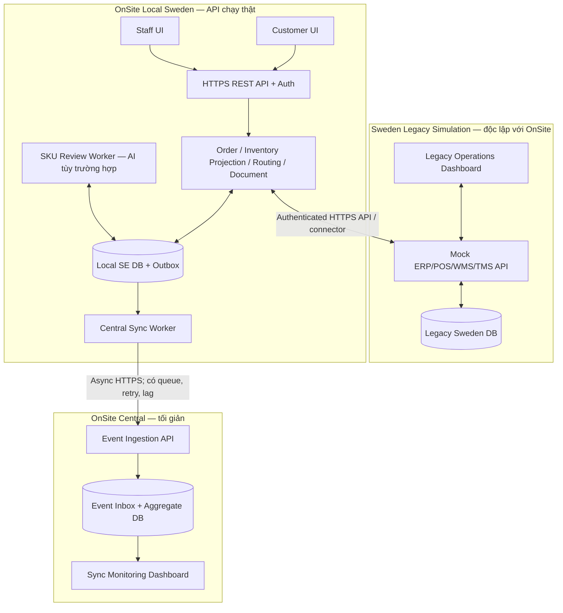
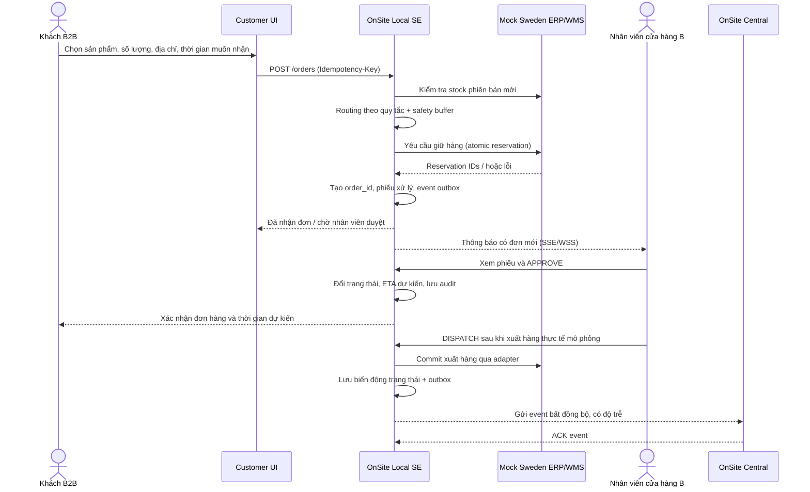

# OnSite — Kế hoạch xây dựng MVP Round 2

> **Đội thi:** PYRAMID  
> **Tên giải pháp:** OnSite  
> **Phiên bản kế hoạch:** 1.0 — 04/11/2026  
> **Trạng thái:** Kế hoạch triển khai; không phải tuyên bố hệ thống đã hoàn thành.  
> **Phạm vi:** Một OnSite Local Sweden chạy thật + môi trường doanh nghiệp Thụy Điển giả lập độc lập + OnSite Central tối giản. Denmark và Norway là hướng mở rộng nếu còn thời gian.

## 1. Mục tiêu của bản MVP

Xây dựng bằng chứng kỹ thuật rằng OnSite **kết nối với hệ thống bán lẻ vật liệu xây dựng sẵn có** của một quốc gia, **tự động hóa một phần quy trình đơn hàng B2B**, đồng bộ dữ liệu có kiểm soát và cho phép người vận hành thấy rõ thay đổi trước/sau khi tích hợp API.

**Cần chứng minh trực tiếp:**

1. Một hệ thống giả lập Sweden **tự chạy được khi OnSite chưa kết nối**, gồm cửa hàng, kho, catalog, tồn kho, nhập/xuất, đơn hàng và số liệu giao dịch.
2. **OnSite Local Sweden là backend/API có nghiệp vụ thật**, có database riêng, xác thực, kiểm tra tồn kho, điều phối, phiếu xử lý đơn và sự kiện trạng thái.
3. Khi kết nối qua API, OnSite đọc dữ liệu từ môi trường giả lập và ghi những thay đổi được phép qua connector, **không thay thế dữ liệu gốc**.
4. Khách đặt hàng qua giao diện OnSite; nhân viên cửa hàng nhận phiếu, xác nhận, tiếp tục chuẩn bị/giao hàng; trạng thái và tồn kho thay đổi theo giao dịch thật trong môi trường mô phỏng.
5. Phát hiện **SKU mới/chưa có trong danh mục chuẩn của OnSite**; AI hỗ trợ đề xuất thông tin/đối chiếu khi cần; nhân viên xác minh và duyệt trước khi dùng mapping. Không giả định các cửa hàng trong cùng quốc gia bắt buộc có mã SKU khác nhau.
6. **OnSite Central tối giản** tiếp nhận sự kiện/dữ liệu được chia sẻ từ Local một cách bất đồng bộ, hiển thị **độ trễ đồng bộ có thật**, không phải cập nhật tức thì. Local tiếp tục nhận và xử lý đơn khi Central tạm ngừng kết nối.
7. Có số liệu kiểm thử để đánh giá **thời gian xử lý, thao tác thủ công, độ trễ dữ liệu, độ tin cậy**. Mọi chỉ số là kết quả đo từ demo hoặc được gắn nhãn giả định; không tự tuyên bố doanh thu tăng do chỉ phát sinh đơn.

### 1.1. Quyết định phạm vi

| Thành phần | Trạng thái kế hoạch | Ghi chú |
|---|---|---|
| Sweden Legacy Simulation | **Phải có** | 10 cửa hàng A–J + 1 hub trong dữ liệu; ban đầu thử với 2 cửa hàng + 1 hub |
| OnSite Local SE + API + DB | **Phải có** | Hệ thống xử lý thật theo logic demo |
| Customer UI và Staff UI | **Phải có** | Giao diện mỏng dùng Local API, không xử lý nghiệp vụ phía trình duyệt |
| Mock ERP/POS/WMS/TMS adapters | **Phải có phần tối thiểu** | API giả lập có DB riêng, không chỉ trả JSON cứng |
| Tồn kho / định tuyến / giữ hàng | **Phải có** | Có kiểm tra đồng thời, trạng thái và ghi nhận đầy đủ |
| Dashboard Before / After | **Phải có** | Hai trạng thái có dữ liệu nguồn và phương pháp đo rõ ràng |
| OnSite Central tối giản | **Nên hoàn thành** | Ingest + inbox + sync lag + dashboard cơ bản |
| AI SKU review | **Nên hoàn thành** | Sự kiện SKU mới → gợi ý → duyệt → lưu, có fallback thủ công |
| Denmark / Norway Local | **Tùy thời gian** | Không làm ảnh hưởng khả năng hoàn thành Sweden |
| Hệ thống thanh toán, hóa đơn thuế thật | **Ngoài phạm vi** | Chỉ tạo phiếu đặt/xử lý đơn và xác nhận đặt hàng |
| Tích hợp ERP thật / SMS thật / GPS thật | **Ngoài phạm vi** | Chỉ tích hợp simulator và hiển thị nhãn mô phỏng |

## 2. Sơ đồ kiến trúc MVP



**Nguyên tắc:**

- **Legacy Simulation** và **OnSite Local** có **API + DB riêng**. Khi tắt kết nối, Legacy Simulation vẫn hiển thị và vận hành theo các chức năng của nó. Không dùng chung trực tiếp database giữa hai ứng dụng.
- **ERP/POS/WMS giả lập là nguồn sự thật** cho stock vật lý và các giao dịch xuất/nhập; OnSite lưu bản đọc chuẩn hóa, phiên bản và tuổi dữ liệu, chỉ thay đổi tồn kho gốc thông qua API/adapter có quyền ghi/giữ hàng.
- **OnSite Local SE là nguồn sự thật** cho đơn hàng được tạo trên OnSite, trạng thái điều phối, phiếu xử lý, audit log và outbox.
- **Central là bản sao tổng hợp**, không là nơi xác nhận từng đơn, giữ hàng hay ghi đè dữ liệu quốc gia.
- Không có lời hứa **zero latency**: Local giảm phụ thuộc đường truyền xuyên quốc gia, còn các đường đồng bộ và truy xuất vẫn có độ trễ.

## 3. Môi trường Thụy Điển giả lập (Sweden Simulation)

### 3.1. Dữ liệu seed

- **10 cửa hàng:** Store A, B, C, D, E, F, G, H, I, J; mỗi cửa hàng có `store_id`, tên, khu vực, vị trí giả định, trạng thái, giờ phục vụ.
- **01 regional hub:** Hub SE-01, có tồn kho và khả năng cấp hàng cho các cửa hàng.
- **Danh mục:** ưu tiên nhóm sản phẩm B2B bán chạy của vòng 1 (xi măng, gỗ, thạch cao, vật liệu cách nhiệt). Dùng mã sản phẩm thống nhất trong Sweden theo mặc định.
- **Tồn kho:** `on_hand`, `reserved`, `available`, lịch sử nhập/xuất, `updated_at`, `version`, nguồn cập nhật.
- **Đơn hàng cũ:** đơn mô phỏng đã hoàn thành / chờ xử lý để dựng màn hình hoạt động trước kết nối.
- **Số liệu:** số đơn, số lượng nhập kho, số lượng xuất kho, tổng giá trị đơn đặt, doanh thu ghi nhận trong mô phỏng theo quy tắc đã định; tránh nhập số tùy tiện chỉ để dashboard trông tăng mạnh.
- **Kịch bản lỗi:** mất kết nối WMS, stock thay đổi trong lúc đặt, hai đơn cùng đặt một sản phẩm, sản phẩm mới.

### 3.2. Màn hình Sweden trước kết nối

- Danh sách cửa hàng A–J và hub; có thể bấm vào xem inventory, inbound/outbound, đơn hàng, số liệu giao dịch và các sự kiện gần nhất.
- Trạng thái kết nối OnSite: **Disconnected**; các thao tác ở môi trường cũ vẫn chạy độc lập.
- Đối với một đơn mẫu, hiển thị các bước xử lý thủ công theo kịch bản cố định (tra tồn kho từng nơi, chọn nguồn cấp, lập phiếu, cập nhật thủ công) để có đối chứng khi đo.
- **Không giả định Sweden có SKU không thống nhất giữa các cửa hàng** trừ khi xuất hiện dữ liệu thật hoặc ca mô phỏng được ghi rõ là ngoại lệ.

### 3.3. Mock API cần có

Các đường dẫn là **đề xuất**, thống nhất sau khi chọn stack:

| API giả lập | Mục đích |
|---|---|
| `GET /legacy/stores` | Danh sách 10 cửa hàng và hub |
| `GET /legacy/products` | Catalog và metadata |
| `GET /legacy/inventory?since=...` | Stock snapshot / delta, có `updated_at` và `version` |
| `POST /legacy/reservations` | Giữ hàng nguyên tử cho đơn OnSite, trả kết quả hoặc lỗi không đủ hàng |
| `POST /legacy/reservations/{id}/commit` | Chốt giữ hàng / xuất hàng theo trạng thái mô phỏng |
| `DELETE /legacy/reservations/{id}` | Hủy giữ hàng khi nhân viên từ chối hoặc timeout |
| `POST /legacy/receipts` | Ghi nhận nhập hàng giả lập, có nhật ký |
| `GET /legacy/transactions` | Lịch sử nhập/xuất và các chỉ số đối chiếu |

**Lưu ý quan trọng:** Trong demo, giả lập legacy có API giữ hàng để chứng minh an toàn tồn kho. Trong hệ thống doanh nghiệp thật, khả năng này phụ thuộc chức năng ERP/WMS. Nếu hệ thống cũ chỉ cho phép đọc, OnSite **không được** khẳng định đã giữ hàng thành công.

## 4. OnSite Local Sweden: kiến trúc module

| Module | Trách nhiệm |
|---|---|
| API Gateway / Auth | Định danh khách, nhân viên, connector; kiểm tra quyền theo cửa hàng |
| Product / Catalog | Sản phẩm, canonical SKU, mapping đã duyệt và trạng thái cần duyệt |
| Inventory Adapter + Projection | Nhận dữ liệu từ simulator, làm sạch, tính tồn khả dụng và độ mới dữ liệu |
| Order Service | Tiếp nhận đơn, idempotency key, trạng thái, ghi dữ liệu đơn |
| Routing Engine | Chọn nguồn cấp theo tồn khả dụng, khoảng cách giả lập, khả năng xử lý và quy tắc deterministic |
| Reservation Coordinator | Gọi API legacy để giữ hàng; bù trừ/hủy nếu không hoàn tất |
| Order Document Service | Tạo phiếu xử lý nội bộ và xác nhận đặt hàng, không tự nhận là hóa đơn thuế |
| Staff Notification | Thông báo đơn mới qua WebSocket/SSE; REST là nguồn đọc dữ liệu gốc |
| SKU Review Service | Phát hiện SKU mới/không có mapping; đề xuất AI nếu phù hợp và chuyển nhân viên duyệt |
| Event Outbox + Sync Worker | Ghi sự kiện tại Local, đồng bộ Central có retry, ACK, idempotency |
| Metrics / Audit | Log, thời gian xử lý, hoạt động thay đổi, tình trạng kết nối |

### 4.1. API OnSite cần làm trước

| Phương thức + endpoint | Mục đích |
|---|---|
| `GET /api/v1/stores` | Hiển thị các cửa hàng trong Sweden |
| `GET /api/v1/products` | Catalog khách chọn |
| `GET /api/v1/inventory?sku=...` | Tồn kho khả dụng đã chuẩn hóa, kèm `last_synced_at` |
| `POST /api/v1/orders` | Tạo đơn, trả ngay `order_id`, `status`, thời gian ghi nhận |
| `GET /api/v1/orders/{id}` | Đọc trạng thái / lịch sử đơn |
| `GET /api/v1/staff/orders?store_id=...` | Nhân viên được phân quyền xem đơn |
| `POST /api/v1/staff/orders/{id}/approve` | Duyệt đơn sau khi có giữ hàng hợp lệ |
| `POST /api/v1/staff/orders/{id}/reject` | Từ chối, giải phóng giữ hàng |
| `POST /api/v1/staff/orders/{id}/dispatch` | Ghi nhận xuất hàng, cập nhật các dòng phân bổ |
| `GET /api/v1/orders/{id}/confirmation` | Xem/tải thông tin xác nhận đơn và ETA dự kiến |
| `GET /api/v1/sku-review` | Danh sách SKU cần xác minh |
| `POST /api/v1/sku-review/{id}/approve` | Duyệt đề xuất mapping/catalog |
| `GET /api/v1/health` | Tình trạng Local |
| `GET /api/v1/metrics` | Chỉ số đo độ trễ / xử lý / lỗi |

Không cần xây tất cả cùng lúc. Thứ tự: **stores/products/inventory → orders → approval → dispatch/status → metrics → SKU review → Central sync**.

### 4.2. Quy trình một đơn hàng hoàn chỉnh



**Trạng thái tối thiểu:** `PENDING` → `RESERVED` → `AWAITING_APPROVAL` → `APPROVED` → `DISPATCHED` → `DELIVERED`; nhánh `REJECTED` / `CANCELLED` / `FAILED` phải có quy tắc giải phóng stock. **Mã đơn tạo khi tiếp nhận**, không đợi nhân viên duyệt mới tạo.

**Phiếu đơn** cần chứa: mã đơn, tên/ID người mua, cửa hàng, sản phẩm/SKU, số lượng, đơn giá thành tiền (mô phỏng), nguồn xuất, địa chỉ nhận, thời gian khách mong muốn, ETA dự kiến, trạng thái và người duyệt. Phân biệt **phiếu xử lý nội bộ**, **xác nhận đơn cho khách** và **hóa đơn thuế** (ngoài MVP).

### 4.3. Quy tắc phân bổ hàng

- Tính `usable = max(0, on_hand - reserved - safety_stock)`; trong MVP mặc định safety stock 10% theo đề xuất vòng 1, nhưng quy tắc làm tròn phải được quy định rõ.
- Từ các điểm có hàng khả dụng và đủ điều kiện, ưu tiên khoảng cách vận chuyển giả lập và năng lực xử lý. Nếu một nơi không đủ, có thể **split** giữa nhiều điểm.
- Thời gian giao khách muốn nhận là yêu cầu, **không phải cam kết ETA**. ETA được sinh theo quy tắc minh bạch của simulator.
- Nếu hàng đã được đồng thời giữ bởi đơn khác, adapter trả xung đột và Local tính lại hoặc báo không thể đáp ứng.
- Không tự động tăng doanh thu tại bước tạo đơn. Chỉ số giá trị đơn đặt và doanh thu hoàn thành phải tách riêng.

## 5. SKU mới và AI: demo đúng vai trò

**Không tạo tình huống giả bắt buộc rằng Store A và Store B cùng nước dùng SKU khác nhau.** Demo AI theo một sự kiện hợp lý: **Legacy Simulation nhập một sản phẩm mới** mà OnSite chưa có trong catalog chuẩn.

1. Mock ERP phát sinh `product.created` với tên, nhãn hàng, quy cách, đơn vị, mã nhà cung cấp.
2. Local nhận sản phẩm mới và đánh dấu `PENDING_REVIEW` nếu chưa kiểm tra/chuẩn hóa.
3. Worker kiểm tra dữ liệu có cấu trúc theo quy tắc xác định trước. AI **chỉ hỗ trợ đề xuất đối chiếu/mô tả/nhóm sản phẩm** khi thực sự thiếu hoặc mơ hồ thông tin.
4. Giao diện nhân viên hiển thị **nguồn dữ liệu, đề xuất, mức tin cậy nếu đã hiệu chỉnh, lý do, nút duyệt hoặc từ chối**.
5. Người có quyền duyệt. Khi duyệt, Local lưu mapping với `approved_by`, `approved_at`, `mapping_version` và `source_product_id`.
6. Các đơn sau sử dụng **mapping đã duyệt**; không bắt buộc gọi AI trên từng request.
7. Local gửi **sự kiện metadata đã duyệt** lên Central (không gửi dữ liệu cá nhân khách hàng nếu không cần).

**Ranh giới:** AI không được tự đoán `1 pallet = N bao` hay tự sửa tồn kho/giá. Hệ số quy đổi phải đến từ quy cách sản phẩm đã kiểm chứng. Nếu không xây được mô hình AI thật, ghi rõ fallback `manual SKU review` thay vì giả vờ AI đang hoạt động.

**Kiểm thử AI nếu triển khai:** tạo 50–100 trường hợp đối chiếu/metadata có nhãn đánh giá; tách tập hiệu chỉnh và tập kiểm tra độc lập nếu có thể; ghi kết quả chấp nhận/từ chối, không mặc nhiên dùng ngưỡng 95% như một độ chính xác đã được chứng minh.

## 6. Đồng bộ near-real-time: có delay, giảm phụ thuộc Central

Ba loại độ trễ khác nhau cần được đo **riêng**:

| Chỉ số | Đo từ đâu đến đâu | Ý nghĩa |
|---|---|---|
| `api_latency_ms` | Request → Response của OnSite Local | Hiệu năng tương tác nội địa |
| `inventory_freshness_ms` | Thời điểm ERP cập nhật → Local áp dụng snapshot | Độ cũ của dữ liệu tồn kho |
| `central_sync_lag_ms` | Thời điểm sự kiện commit ở Local → Central ghi nhận | Độ trễ đồng bộ liên hệ thống |

**Vì sao đặt Local theo quốc gia có ích:** request của khách/nhân viên Sweden được phục vụ bởi dịch vụ và data store Sweden; luồng điều phối đơn **không chờ Central**. Thiết kế này *có thể* giảm độ trễ/độ phụ thuộc liên quốc gia, nhưng hiệu quả thực tế còn phụ thuộc vị trí hạ tầng, kết nối ERP, độ tải và cấu hình. Không tuyên bố một con số tốc độ khi chưa đo.

**Cách làm:**

1. Khi một giao dịch của Local thay đổi, lưu trạng thái nghiệp vụ **và outbox event trong cùng một DB transaction**.
2. Sync worker gửi event tới Central qua HTTPS; có `event_id`, `country=SE`, `aggregate_id`, `version`, `occurred_at`.
3. Central lưu `event_id` trong inbox có unique constraint; nhận lại cùng event thì ACK nhưng **không áp dụng lần hai**.
4. Nếu Central mất mạng, Local giữ pending event; retry theo backoff, phát lại sau khi kết nối khôi phục.
5. Central hiển thị `last_seen`, `last_event_at`, số lượng pending, trạng thái online/offline và độ trễ đo được.
6. Để trình diễn rõ, **có thể cấu hình độ trễ mạng nhân tạo (ví dụ 2–5 giây)**; phải dán nhãn `simulated delay`, không đưa con số này thành số đo độ trễ hạ tầng thực.

**Chống chồng chéo dữ liệu:** Local SE giữ quyền ghi đơn Sweden. Central chỉ ghi bản tổng hợp. Dùng namespace `SE:{entity_type}:{id}`; kiểm soát version, unique event ID, transaction, retry và audit. **Tách DB hoặc mã hóa riêng không tự ngăn event trùng và ghi đè.**

## 7. Database, mã hóa và bảo mật cho MVP

- **Tách ít nhất 3 database/schema/credential logic:** Legacy Sweden DB, OnSite SE Operational DB, Central Aggregate DB; không cho một ứng dụng đọc trực tiếp DB của ứng dụng còn lại.
- **OnSite SE DB** lưu order, order items, allocations, stock projection, reservations, SKU review, audit, outbox. Không lưu thừa thông tin cá nhân.
- **Dữ liệu lưu trữ:** dùng mã hóa ổ đĩa/volume hoặc managed database encryption nếu môi trường có hỗ trợ; trường nhạy cảm có thể mã hóa ứng dụng theo AES-256-GCM với key riêng cho SE. Không được tuyên bố 'mã hóa at rest' nếu triển khai local chưa thực sự bật.
- **Khóa:** không lưu secret trong Git; `.env.example` chỉ chứa placeholder. Trong MVP local có thể inject secret bằng biến môi trường hoặc secret manager. Trong production cần KMS và quyền/khóa riêng theo quốc gia (SE, DK, NO) khi các Local ấy được xây.
- **Giao tiếp:** HTTPS/TLS khi triển khai qua mạng; local development có thể dùng `localhost` với lưu ý rõ về chế độ dev. Phân quyền customer/staff/admin/connector; mỗi staff bị giới hạn theo `store_id`.
- **Central:** chỉ nhận sự kiện, thống kê, metadata được phép chia sẻ; không có khóa giải mã dữ liệu nhạy cảm của Local SE.
- **Chống sửa trùng:** idempotency key cho tạo đơn, unique DB constraint, optimistic versioning và reservation atomic tại simulator.
- **Nhật ký:** lưu trace ID, request ID, actor, store, outcome, timestamp và lỗi; loại bỏ secret/PII khỏi log.

## 8. Kịch bản trình diễn cho ban giám khảo

Nên chuẩn bị **một bộ dữ liệu seed có thể reset**, các sự kiện có đầu vào cố định và log có thể mở để giám khảo theo dõi.

| Phần demo | Thao tác | Bằng chứng trực quan cần thấy |
|---|---|---|
| **A. Trước tích hợp** | Mở Sweden Simulator, chọn Store B, xem tồn, nhập/xuất, đơn và dashboard | Simulator chạy độc lập, trạng thái OnSite Disconnected |
| **B. Kết nối API** | Bật connector OnSite SE, chạy initial sync | Dữ liệu chuyển qua API thật, hiển thị số record, log request và freshness |
| **C. Đặt hàng** | Khách chọn sản phẩm, 100 đơn vị, địa chỉ và ngày mong muốn | Local tạo order ID, kiểm tra usable stock, phân bổ Store B + Hub khi đủ |
| **D. Nhân viên xử lý** | Staff B nhận phiếu, duyệt, xác nhận xuất hàng | Trạng thái thay đổi; lịch sử và số liệu xuất kho cập nhật đúng thời điểm |
| **E. SKU mới** | Simulator thêm sản phẩm mới → AI (nếu có) đề xuất → Staff duyệt | Review queue, thông tin đối chiếu, mapping đã duyệt và lịch sử |
| **F. Đồng bộ Central** | Xem Central nhận sự kiện trễ; tắt/bật kết nối Central | Local vẫn vận hành; số pending tăng khi offline, tự giảm khi đồng bộ lại; không nhân đôi |
| **G. So sánh hiệu quả** | Chạy cùng một đơn theo quy trình thủ công mẫu và theo OnSite | Thời gian, số bước, lỗi/mức độ can thiệp; có chú thích điều kiện mô phỏng |

### 8.1. Kịch bản stock minh họa

- Store B có `60` đơn vị on-hand, Hub có `60` đơn vị on-hand, chưa reserved.
- Nếu safety stock 10% và làm tròn xuống theo chính sách của MVP, mỗi nơi còn **54** khả dụng.
- Khách đặt **100** đơn vị: ví dụ phân bổ 54 từ Store B và 46 từ Hub **nếu** đáp ứng quy tắc tuyến, thời gian và reservation thành công.
- Sau khi được giữ hàng, `reserved` tăng; `on_hand` **chưa tự giảm chỉ vì khách đặt**. Khi có nghiệp vụ xuất kho thật trong simulator, mới ghi `outbound` và giảm `on_hand` theo quy tắc ledger.
- Nếu khách hủy/từ chối, Local giải phóng lượng reserved theo API.

### 8.2. Before/After cần đo những gì?

| Chỉ số | Cách lấy | Không nên diễn giải sai |
|---|---|---|
| Thời gian xử lý một đơn | Dấu thời gian ở cả luồng thủ công mẫu và luồng OnSite | Demo simulation không phải bằng chứng triển khai thật |
| Số bước nhập/tra cứu thủ công | Đếm tương tác trong cùng kịch bản | Không tính các bước chưa thực sự loại bỏ |
| Tỷ lệ hoàn tất đơn | Số đơn hoàn tất / số đơn kiểm thử | Không suy ra KPI doanh nghiệp trên toàn thị trường |
| Tồn kho / nhập/xuất | Ledger / stock snapshots từ Legacy simulator | Đặt đơn ≠ nhập hàng; duyệt đơn ≠ đã xuất kho |
| Giá trị đơn đặt / doanh thu ghi nhận | Tách giá trị order và doanh thu đã hoàn tất | Không tự nhận tăng doanh thu vì chạy API |
| Độ trễ | Trace + timestamps | Phân biệt delay mạng giả lập với delay đo thật |

**Không đặt sẵn kết quả “tiết kiệm X%”**. Đo trước/sau bằng cùng dữ liệu. Nếu muốn nêu mức tác động tại Denmark/Norway trong tương lai, chỉ viết đó là **giả thuyết cần kiểm chứng**, không công bố phần trăm không có căn cứ.

## 9. Roadmap triển khai theo cổng nghiệm thu

**Hạn BTC:** 22:00 ngày **09/11/2026** (GMT+7). Trọng tâm là một luồng Sweden hoạt động ổn định; có thể chạy local. Các giai đoạn dưới đây là kế hoạch đề xuất và có thể thực hiện song song khi nhóm đủ người.

| Giai đoạn | Mục tiêu | Cổng nghiệm thu (Definition of Done) |
|---|---|---|
| **P0 – Chốt schema & seed** | Quy định bảng, trạng thái và bộ dữ liệu Sweden | Seed reset được, có 10 stores + hub, stock và ledger nhất quán |
| **P1 – Legacy Sweden Simulator** | Màn hình trước kết nối + mock API có DB riêng | Simulator chạy độc lập; thay đổi nhập/xuất cập nhật DB thật |
| **P2 – Local SE API core** | Stores/products, inventory adapter, order, routing, reservation | Gọi API từ Postman/Swagger chạy đủ luồng; không oversell khi đồng thời |
| **P3 – Customer + Staff UI** | Đặt hàng và duyệt/xuất hàng | 1 đơn từ đầu đến cuối, thông tin/phiếu đúng, UI cập nhật bằng API |
| **P4 – Central tối giản** | Outbox, receiver, inbox, lag dashboard | Ngắt Central Local vẫn chạy, reconnect đồng bộ đúng 1 lần về mặt kết quả |
| **P5 – SKU review / AI** | Sản phẩm mới và đề xuất duyệt | Có nguồn metadata, duyệt/từ chối, mapping version/audit; AI thật hoặc ghi rõ fallback |
| **P6 – Hardening & evidence** | Test lỗi và quay video, làm PDF tài liệu | Video ≤7 phút; journey/diagram ≤2 trang/file; AI Journal theo mẫu |
| **Stretch – DK/NO** | Mô phỏng thêm quốc gia | Chỉ khi P0–P6 hoàn thành; mỗi Local độc lập, không phá Sweden |

### 9.1. Phân công công việc theo workstream (không giả định số người)

- **Backend/API:** contracts, transactions, inventory adapter, routing, reservations, order state machine.
- **Simulation/Data:** legacy simulator, seed, mock endpoints, stock ledger, kịch bản before/after.
- **Frontend/Demo:** customer UI, staff UI, monitoring, kịch bản demo, khả năng reset.
- **AI/Quality:** SKU review, tập test, regression, log đối chiếu, AI Journal.
- **Integration/DevOps:** docker-compose, env, local/central sync, auth, deployment và quay video.

Một người có thể phụ trách nhiều workstream; không cần dựng microservices vật lý chỉ để chia việc. **Local SE có thể là modular monolith** với các module nội bộ tách rõ, giúp hoàn thành sớm và tránh lỗi phân tán không cần thiết.

### 9.2. Thứ tự ưu tiên nếu thiếu thời gian

1. **Không được cắt:** simulator độc lập + Local API xử lý đơn thật + kiểm tra tồn + phiếu + staff approval + chứng minh dữ liệu thay đổi đúng.
2. **Ưu tiên tiếp theo:** Central minimal để chứng minh Local không phụ thuộc Central và near-real-time có delay.
3. **Nếu đủ thời gian:** AI SKU review thật (hoặc review thủ công được ghi rõ), kiểm thử đối chứng sâu.
4. **Cắt trước:** mô phỏng Denmark/Norway, thanh toán, tối ưu lộ trình bằng bản đồ thật, SMS, hóa đơn thuế và thiết kế giao diện quá phức tạp.

## 10. Kiểm thử bắt buộc

- **TC01:** Sweden Simulator vận hành được khi OnSite tắt.
- **TC02:** Sync ban đầu nhận đủ cửa hàng/sản phẩm/tồn kho; record lỗi có log.
- **TC03:** Một đơn đủ hàng tạo đúng `order_id`, phiếu và reservation.
- **TC04:** Hai đơn đồng thời không giữ vượt hàng khả dụng.
- **TC05:** Hết hàng hoặc thay đổi stock lúc checkout → xử lý rõ lỗi/đề xuất thay thế.
- **TC06:** Phân bổ qua Store B và Hub; stock/reservation từng điểm đúng.
- **TC07:** Staff B không xem/duyệt đơn của Store A nếu không có quyền.
- **TC08:** Duyệt, từ chối, xuất hàng tạo đúng state transition; từ chối trả reservation.
- **TC09:** Gửi lặp `Idempotency-Key` không tạo hai đơn.
- **TC10:** Thêm sản phẩm mới: OnSite đưa vào review, chỉ mapping đã duyệt mới dùng cho routing khi cần.
- **TC11:** Tắt Central; Local tiếp tục đặt hàng; outbox tồn tại bền vững.
- **TC12:** Bật lại Central; sync bù không nhân đôi event, metric lag hiển thị đúng.
- **TC13:** Mất kết nối ERP simulator: stock được báo stale, không âm thầm hứa giữ hàng khi chưa được ERP xác nhận.
- **TC14:** Reset và tái chạy kịch bản demo tạo cùng kết quả theo seed và quy tắc đã khóa.
- **TC15:** Không có mật khẩu/API key thật, dữ liệu cá nhân thật hoặc khóa mã hóa trong repo, video hay các file nộp.

## 11. Công nghệ đề xuất (chưa phải quyết định bắt buộc)

Để giảm rủi ro tích hợp: 

| Lớp | Lựa chọn gọn cho MVP | Lý do |
|---|---|---|
| Frontend | React + TypeScript + Vite | Customer UI, Staff UI, dashboards |
| Local SE Backend | Node.js + TypeScript (Fastify hoặc NestJS) | REST API có validation và module dễ bảo trì |
| Mock Sweden Backend | Node.js/TypeScript, **service độc lập** | API thật và database giả lập riêng |
| Database | PostgreSQL | Transactions, unique constraint, audit, outbox |
| DB access | Prisma hoặc Drizzle | Migrations và type safety |
| Central receiver | API Node.js + PostgreSQL nhỏ | Inbox, aggregate và sync lag |
| Event sync | Worker polling outbox | Không bắt buộc dùng Kafka/RabbitMQ trong MVP |
| Live staff notification | SSE hoặc WebSocket | Thông báo; dữ liệu chuẩn vẫn đọc bằng REST |
| Local orchestration | Docker Compose | Dựng và reset nhanh toàn bộ stack |
| API inspection | Swagger/OpenAPI + Postman | Ban giám khảo kiểm tra API thật |

**Một cấu trúc thư mục đề xuất:**

```text
onsite-mvp/
├── README.md
├── .env.example
├── compose.yaml
├── apps/
│   ├── sweden-simulator/      # Legacy dashboard + mock APIs
│   ├── onsite-local-se/       # API + domain modules + sync worker
│   ├── customer-web/          # Giao diện khách
│   ├── staff-web/             # Giao diện cửa hàng
│   └── onsite-central/        # Event receiver + minimal monitoring
├── packages/
│   ├── api-contracts/         # Request/response/event schemas
│   └── shared-types/          # DTO; không truy cập DB chéo
├── seed/
│   ├── sweden-stores.json
│   ├── sweden-products.json
│   └── demo-scenarios.json
├── tests/
│   ├── integration/
│   ├── e2e/
│   └── concurrency/
└── docs/
    ├── user-journey.md
    ├── system-context.md
    └── ai-journal-notes.md
```

**Hạn chế kiến trúc:** DB/key KMS tách biệt ba nước là **thiết kế mở rộng**, nhưng MVP một Local chỉ có thể chứng minh khóa SE, phân quyền và cách ly SE–Central. Không được tuyên bố đã kiểm thử 3 miền khóa nếu DK/NO chưa chạy. Tương tự, thử nghiệm nội bộ không tự chứng minh tuân thủ pháp luật dữ liệu của từng nước.

## 12. Gói demo và tài liệu nộp BTC

Theo tài liệu Round 2, nhóm cần:

1. **Functional MVP + video MP4 tối đa 7 phút:** demo trước/sau kết nối, một đơn xử lý hoàn chỉnh, AI SKU review (nếu đã làm), sync lag và mất kết nối Central.
2. **User Journey PDF tối đa 2 trang:** hai actor chính là khách và nhân viên; từ đặt đơn đến nhận xác nhận, kèm xử lý tự động trong Local. Không cần mô tả mọi màn hình.
3. **System Context Diagram PDF tối đa 2 trang:** các ranh giới **Legacy Sweden Simulation ↔ OnSite Local SE → OnSite Central**, API, DB, nguồn sự thật và luồng near-real-time có độ trễ; DK/NO đánh dấu future scope.
4. **AI Engineering Journal PDF theo template:** ghi đúng công việc AI thực sự hỗ trợ, thời gian, kiểm chứng và quyết định của nhóm; không bịa kết quả kiểm thử.
5. **Tệp gửi được mở bởi BTC**, tên rõ ràng, không chứa secret. Gửi email `EB.VN@netcompany.com`, tiêu đề `Round 2 – Team PYRAMID`, trước **22:00 (GMT+7), 09/11/2026**.

### 12.1. Video mẫu tối đa 7 phút (phân bổ đề xuất)

| Phần | Thời lượng gợi ý | Nội dung |
|---|---:|---|
| Bối cảnh và Before | 0:00–0:50 | Đau điểm, simulator Sweden đang chạy độc lập |
| Kết nối API | 0:50–1:40 | Bật connector, xem sync và API requests |
| Customer đặt hàng | 1:40–2:50 | Đơn mới, routing, reservation, phiếu |
| Staff xác nhận | 2:50–3:50 | Duyệt, dispatch, số liệu tồn và outbound cập nhật |
| SKU review | 3:50–4:40 | Chỉ trình diễn nếu AI/review thực sự chạy |
| Central + network fault | 4:40–5:50 | Lag, offline, retry, replay an toàn |
| Kết quả / giới hạn / mở rộng | 5:50–7:00 | Before/after đo thật, nêu DK/NO là hướng tiếp theo |

Nếu một tính năng chưa chạy ổn, **giảm phần demo**, không quay một luồng giả rồi gọi là hoạt động thật.

## 13. Tiêu chí xác nhận MVP hoàn thành

MVP chỉ coi là sẵn sàng khi:

- [ ] Legacy Sweden chạy độc lập; có 10 cửa hàng + 1 hub trong dataset.
- [ ] OnSite Local SE chạy thật, có DB riêng, REST endpoints, xác thực cơ bản, audit.
- [ ] Kết nối legacy bằng HTTP API, không truy cập trực tiếp DB chéo.
- [ ] Có ít nhất một đơn hoàn chỉnh: customer → route → reserve → staff approval → dispatch → customer status.
- [ ] Phiếu có thông tin khách, cửa hàng, SKU, số lượng, nguồn xuất, thời gian mong muốn, ETA và trạng thái.
- [ ] Tồn kho và nhập/xuất có thay đổi đúng quy tắc khi giao dịch xảy ra.
- [ ] Test không oversell, không tạo trùng đơn và không ghi nhận sai doanh thu.
- [ ] Central nhận ít nhất một luồng sự kiện có timestamp/lag; offline không chặn Local nếu Central đã triển khai.
- [ ] Nếu demo AI, có quy trình đề xuất/duyệt và nêu rõ nguồn dữ liệu, không để AI tự quyết toán tồn kho.
- [ ] Có lệnh reset demo, log/metrics để chứng minh chức năng.
- [ ] Hai PDF sơ đồ và AI Journal phản ánh đúng những gì đã xây và kiểm thử.

---

## 14. Định hướng sau vòng 2

- **Sweden:** Nâng độ tin cậy connector, thiết lập SLA dữ liệu, xử lý multi-node fulfilment và các nghiệp vụ giao hàng thực tế; khảo sát ERP/WMS/POS thật trước tích hợp production.
- **Denmark:** Triển khai **Local DK + DB/khóa riêng**, ưu tiên số hóa đầu vào đơn hàng thủ công và adapter theo hệ thống hiện có; dùng chung API contract, không copy dữ liệu khách Sweden sang Denmark.
- **Norway:** Triển khai **Local NO + DB/khóa riêng**, ưu tiên store operations và stock visibility; khác module nghiệp vụ nhưng dùng cùng chuẩn sự kiện chung.
- **OnSite Central:** Dashboard đa quốc gia, canonical metadata chia sẻ có kiểm duyệt, giám sát độ trễ và sức khỏe connector; không thay vai trò ghi dữ liệu gốc tại mỗi nước.
- **Đo hiệu quả:** Thử nghiệm trên dữ liệu vận hành thật có đối chứng trước khi tuyên bố mức phần trăm cải thiện hoặc giá trị tài chính.

**Thông điệp demo cần giữ nhất quán:** OnSite không thay ERP của công ty. Hệ thống đưa một lớp API và điều phối lên trên hệ thống có sẵn; Local Sweden xử lý đơn nội địa độc lập, Central nhận dữ liệu có độ trễ và khả năng phục hồi. **Phần đang chạy thực tế trong MVP phải luôn được phân biệt với môi trường và số liệu giả lập, cũng như các kế hoạch DK/NO.**
