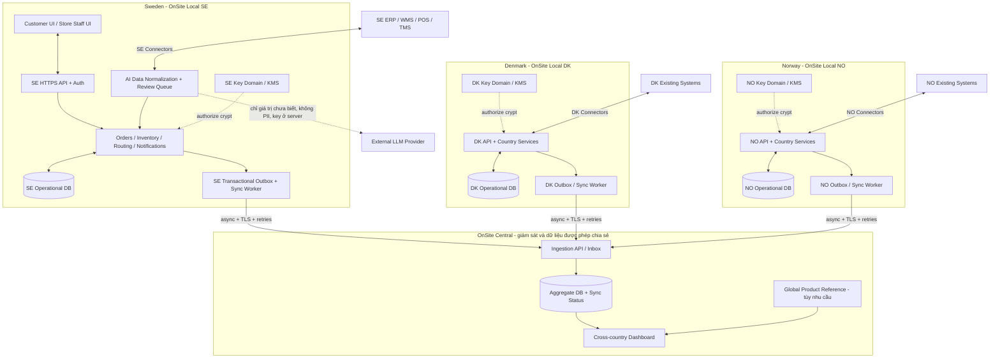
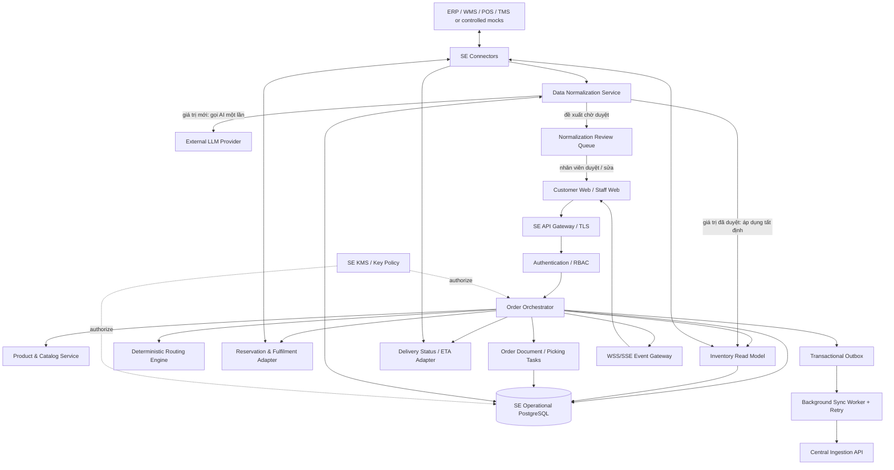
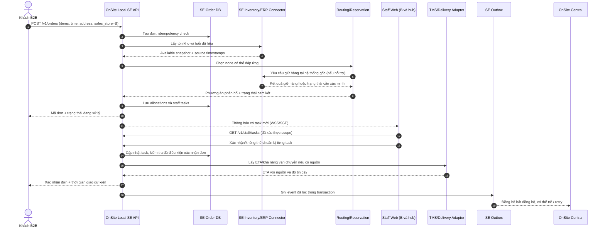
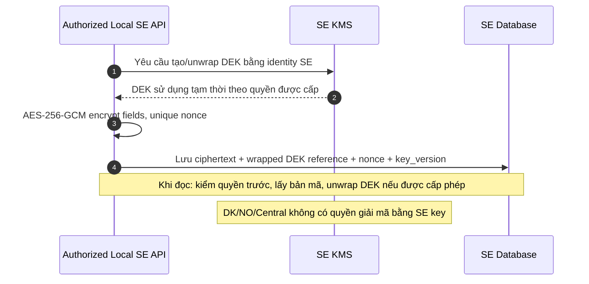
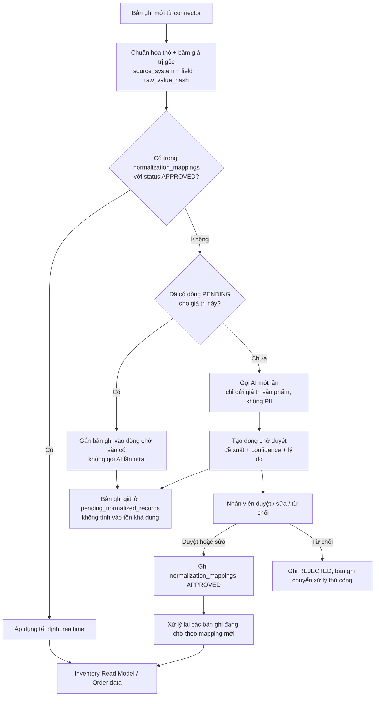

# KIẾN TRÚC HỆ THỐNG ONSITE

**Đội phát triển:** PYRAMID  
**Tên giải pháp:** OnSite  
**Phiên bản:** 2.1 — 04/11/2026 (cập nhật vai trò AI: chuẩn hóa dữ liệu realtime có duyệt)  
**Loại tài liệu:** Đặc tả kiến trúc kỹ thuật làm cơ sở phát triển MVP và mở rộng  
**Phạm vi ưu tiên:** Sweden (SE); thiết kế có thể mở rộng đến Denmark (DK), Norway (NO)  
**Trạng thái:** **Kiến trúc đề xuất**, không phải mô tả hệ thống đã triển khai đầy đủ.

> **Quyết định cốt lõi:** Mỗi quốc gia vận hành **một OnSite Local riêng** gồm API/Backend, dữ liệu nghiệp vụ, connector và miền khóa mã hóa độc lập. Local xử lý đơn hàng nội địa mà **không cần chờ OnSite Central**. Central chỉ nhận các sự kiện/dữ liệu tổng hợp được phép chia sẻ và giám sát hoạt động đa quốc gia. Đồng bộ dữ liệu là **gần thời gian thực, luôn có khả năng trễ**. Phân tách Local giúp giảm phụ thuộc liên quốc gia và giới hạn vùng dữ liệu bị tác động; để tránh trùng hoặc ghi đè sai vẫn cần cơ chế kiểm soát giao dịch cụ thể.

---

## 1. Bài toán, ranh giới và mục tiêu

### 1.1. Vấn đề thực tế cần giải quyết

Theo bài toán vòng 1, Company A là một doanh nghiệp bán lẻ vật liệu xây dựng hoạt động tại **Thụy Điển, Đan Mạch và Na Uy**. Tất cả cửa hàng thuộc cùng doanh nghiệp, nhưng công ty đang đối mặt với các thách thức vận hành khác nhau theo quốc gia/khu vực. Việc vận hành đa quốc gia không tự động có nghĩa mỗi cửa hàng trong một nước sử dụng SKU khác nhau.

| Khu vực | Bài toán ưu tiên đã nêu | OnSite tác động bằng cách nào |
|---|---|---|
| **Sweden** | Delivery & fulfilment | Tiếp nhận đơn B2B, nhìn thấy tồn kho khả dụng tại nhiều điểm, đề xuất nơi xuất hàng, chia đơn khi cần, chuẩn bị phiếu xử lý, xác nhận và cập nhật tiến độ giao hàng |
| **Denmark** | Manual processes | Kết nối và số hóa các bước nhập/trao đổi đơn thủ công; có thể bổ sung AI đọc đơn dạng văn bản nếu thực tế cần |
| **Norway** | Store operations | Đồng bộ trạng thái công việc và dữ liệu tồn kho phục vụ nhân viên cửa hàng, giảm thao tác tra cứu nhiều hệ thống |
| **Toàn doanh nghiệp** | Fragmented systems | Một chuẩn giao tiếp/cấu trúc dữ liệu giữa các Local, giám sát đa quốc gia và khả năng mở rộng mà không thay toàn bộ ERP |

**Không có căn cứ để khẳng định:** các cửa hàng ở Sweden hiện dùng mã hàng khác nhau hoặc kho trung tâm nhất thiết ghi theo pallet trong khi cửa hàng ghi theo bao. Kiến trúc **không lấy giả định đó làm điều kiện để hoạt động**.

**Điều có căn cứ:** dù dùng chung mã hàng, các hệ thống nguồn khác nhau (POS cửa hàng, WMS hub, TMS, file/email từ đối tác) vẫn trả dữ liệu **khác định dạng**: tên trường, cách ghi đơn vị (`st`, `säck`, `pall`, `bag`), mô tả tự do tiếng Thụy Điển, định dạng thời gian. Đây là nơi AI chuẩn hóa dữ liệu được đặt (mục 11).

### 1.2. Mục tiêu kiến trúc

1. **Đơn hàng xử lý nội địa:** khách hàng và nhân viên Sweden sử dụng Local SE; Local SE tự điều phối với các hệ thống kho/cửa hàng tại Sweden.
2. **Không tạo ERP mới:** OnSite là lớp API/điều phối và giao diện sử dụng ngay; ERP/WMS/POS/TMS vẫn giữ vai trò hệ thống gốc theo phạm vi tích hợp.
3. **Phân tán theo quốc gia:** mỗi Local có runtime, DB, quyền truy cập, khóa và hàng đợi sự kiện tách biệt.
4. **Độ trễ có thể đo:** phân biệt tốc độ trả lời API, tuổi dữ liệu tồn kho và độ trễ đồng bộ lên Central; không quảng cáo “không độ trễ”.
5. **Dữ liệu không chồng chéo quyền ghi:** thông tin đơn nội địa chỉ do một Local sở hữu; Central chỉ giữ bản tổng hợp/projection.
6. **Bảo mật theo quốc gia:** sử dụng thuật toán mã hóa tiêu chuẩn với **khóa mã hóa riêng cho mỗi nước**, không tự tạo ba thuật toán mã hóa khác nhau.
7. **Có thể chứng minh trong MVP:** làm được một luồng đặt hàng–phân bổ–xác nhận có trạng thái thật, không chỉ hình ảnh giao diện hoặc các API phản hồi giả không liên kết.
8. **AI chuẩn hóa dữ liệu có kiểm soát:** AI xử lý realtime dữ liệu mới/chưa biết, kết quả chỉ là **đề xuất chờ duyệt**; dữ liệu đã duyệt được áp dụng tự động, tất định, không gọi lại AI.

### 1.3. Quy định về nguồn và giả định

- **Từ đề xuất vòng 1:** ưu tiên Sweden; kế hoạch thí điểm B2B tại **10 cửa hàng + 1 hub**, nhắm vào nhóm SKU bán chạy; cơ chế safety stock 10% được đề xuất; triển khai theo giai đoạn tới DK/NO.
- **Giả định để làm MVP:** dữ liệu mô phỏng cho 11 điểm kho/cửa hàng; tích hợp mock ERP/WMS/TMS khi không có hệ thống thật; hệ thống nhân viên sử dụng giao diện riêng; quy tắc phân bổ ban đầu theo dữ liệu xác định; ít nhất một nguồn mock trả dữ liệu khác định dạng để chứng minh luồng AI chuẩn hóa; AI gọi qua một LLM provider bên ngoài, API key chỉ nằm ở server.
- **Cần xác minh ở doanh nghiệp thật:** quyền gọi API giữ hàng, nguồn tồn kho authoritative, các trạng thái giao hàng, thời gian/địa điểm triển khai hạ tầng, hệ thống nhận dạng người dùng và chính sách phát hành hóa đơn.

---

## 2. Mô hình tổng thể: một Local mỗi quốc gia



### 2.1. OnSite Local là gì?

**Một Local phục vụ toàn bộ các cửa hàng và kho trong phạm vi một quốc gia**, không phải một server vật lý bắt buộc lắp ở từng cửa hàng. Local có thể được đặt tại vùng cloud/data center phù hợp với quốc gia đó, ưu tiên đường truyền đến người dùng và hệ thống nghiệp vụ nội địa. Vị trí gần hơn **có khả năng** giảm round-trip time, nhưng cần đo thực tế, không suy ra tốc độ chỉ từ sơ đồ.

Local bao gồm: API + xác thực, quản lý đơn, dữ liệu tích hợp/đọc tồn kho, bộ phân bổ, phiếu xử lý, thông báo, cơ sở dữ liệu nghiệp vụ, connector, worker đồng bộ, giám sát và miền quản lý khóa riêng.

### 2.2. Central làm gì và không làm gì?

**Làm:** thu nhận dữ liệu sự kiện đã lọc, dashboard hoạt động theo nước, thống kê đơn hàng/giao hàng, theo dõi độ trễ và lỗi sync, quản lý định danh tham chiếu sản phẩm đa quốc gia nếu cần.

**Không làm:** duyệt trực tiếp các giao dịch của cửa hàng, giữ hàng thay Local, ghi đè `orders`/`inventory` trong DB quốc gia hoặc trở thành điểm bắt buộc của mọi lần đặt hàng.

**Hệ quả:** mất kết nối tới Central, **Local SE vẫn có thể tiếp nhận/xử lý đơn SE** nếu Local SE, mạng nội địa và nguồn dữ liệu kho cần thiết còn hoạt động. Điều này không có nghĩa đơn hàng vẫn chạy được khi ERP/WMS nội địa cũng mất kết nối hoặc khách không vào được Local.

### 2.3. Cùng code, khác miền dữ liệu

Một codebase/backend core có thể tái sử dụng giữa SE, DK, NO. Tuy nhiên cần phân tách theo từng nước:

| Thành phần | Tách riêng theo quốc gia? | Ý nghĩa |
|---|---|---|
| Local API / runtime | **Có** | Lỗi Local SE không tự làm ngừng DK/NO |
| Database nghiệp vụ | **Có** | Không dùng chung bảng orders xuyên quốc gia để nhiều nước cùng ghi |
| Tài khoản dịch vụ / secrets | **Có** | Một nước không dùng credentials của nước khác |
| KMS key và quyền sử dụng | **Có** | Tách phạm vi giải mã dữ liệu |
| Outbox / sync offset / DLQ | **Có** | Lỗi đồng bộ một nước không chặn nước khác |
| Adapter kết nối ERP/WMS | **Có, theo hệ thống thực tế** | Khác nhà cung cấp/giao thức thì thay adapter, không đổi core |
| Cấu trúc event/API chung | **Có thể dùng chung hợp đồng** | Central hiểu sự kiện nhưng không sở hữu đơn nội địa |
| Product reference toàn công ty | **Chỉ khi cần** | SKU chung không phải điều kiện bắt buộc ở bước phân bổ Sweden |

---

## 3. Vai trò người dùng và cách cửa hàng kết nối

### 3.1. Ba nhóm tương tác

| Nhóm | Truy cập | Quyền chính |
|---|---|---|
| **Khách B2B** | Customer Web / API của Local quốc gia | Tìm sản phẩm, đặt đơn, khai báo địa chỉ và thời điểm mong muốn, xem trạng thái đơn của mình |
| **Nhân viên cửa hàng/hub** | Staff Web của Local quốc gia | Nhận phiếu công việc được giao, xác nhận/từ chối khả năng chuẩn bị, đóng gói và cập nhật trạng thái đúng scope |
| **Hệ thống ERP/WMS/POS/TMS** | Connector với Local | Cung cấp catalog, dữ liệu tồn kho, giữ/xuất hàng và cập nhật vận chuyển theo quyền tích hợp thực tế |

Central Dashboard dành cho người giám sát đa quốc gia; **không cần có “người dùng thao tác Central” trong luồng chính của khách đặt đơn**.

### 3.2. Cửa hàng B kết nối thế nào?

1. Nhân viên cửa hàng B mở Staff Web và đăng nhập; trình duyệt **chủ động kết nối outbound** tới Local SE qua `HTTPS`.
2. Local SE xác thực phiên đăng nhập và gắn quyền `country=SE`, `store=B`; nhân viên không thể tự sửa `store_id` trên client để xem đơn của cửa hàng khác.
3. Khi Local SE phân công công việc cho B, backend lưu nhiệm vụ vào DB, sau đó **gửi thông báo** bằng WebSocket Secure (`WSS`) hoặc Server-Sent Events (`SSE`).
4. Giao diện dùng REST API đọc trạng thái mới nhất từ backend, ví dụ `GET /v1/staff/tasks?status=pending`.
5. Nhân viên xác nhận bằng `POST /v1/staff/tasks/{taskId}/accept`. Backend kiểm tra quyền và trạng thái trước khi cập nhật.

**Không cần gửi `POST` tới địa chỉ IPv6 của máy tính cửa hàng B.** `POST` là phương thức HTTP, không phải cơ chế định tuyến IPv6. Cửa hàng không cần public IP hoặc mở cổng inbound chỉ để sử dụng Staff Web. Nếu **ERP/POS nội bộ** bắt buộc nhận lệnh tự động thì cần một outbound connector, API server-to-server hoặc queue consumer riêng, không được giả định trình duyệt thực hiện thay hệ thống đó.

### 3.3. WebSocket không phải nguồn dữ liệu chuẩn

WebSocket/SSE chỉ thông báo “đã có thay đổi”. Khi bị ngắt hoặc reload trang, Staff Web gọi REST để tải lại danh sách nhiệm vụ từ DB; không được dùng thông báo WebSocket làm bằng chứng duy nhất rằng đơn đã được lưu.

---

## 4. Kiến trúc kỹ thuật bên trong Local SE



### 4.1. Các service và nguồn dữ liệu

| Service | Chịu trách nhiệm | Không được tự làm |
|---|---|---|
| API Gateway | Xác thực, throttling, correlation ID, routing API | Quyết định hàng có thật trong kho |
| Order Orchestrator | Vòng đời đơn và điều phối các bước | Tự đánh dấu giao xong khi chưa có nguồn xác nhận |
| Product Catalog | SKU của công ty tại quốc gia; thông số/đơn vị xác thực | Tự tạo SKU sai khác để AI có việc làm |
| Inventory Read Model | Lưu snapshot tồn, thời gian cập nhật, nguồn và reservation state | Tự coi snapshot cũ là số lượng chắc chắn có thể bán |
| Routing Engine | Chọn node có hàng khả dụng, xét khả năng giao, chia đơn | Để AI tự đoán tồn kho, giá hay hệ số quy đổi |
| Reservation Adapter | Gửi yêu cầu giữ hàng/xuất hàng đến hệ thống có thẩm quyền | Cam kết đã khóa tồn trên ERP nếu chỉ có kết nối đọc |
| Fulfilment Tasks | Phân công chuẩn bị hàng cho mỗi store/hub | Gộp phê duyệt của hai kho thành một lần click ở B |
| Document Service | Phiếu đơn, phiếu lấy hàng, xác nhận đặt hàng | Tự coi các phiếu này là hóa đơn thuế hợp lệ |
| Notification | Thông báo khách và nhân viên | Thay thế lưu trạng thái bằng database |
| Connector Layer | Biến đổi payload/đồng bộ theo ERP/WMS hiện có | Ghi trực tiếp vào DB legacy khi chưa có quyền và giao diện hỗ trợ |
| Data Normalization Service | Đưa dữ liệu nguồn về schema chuẩn của OnSite; tra bảng mapping đã duyệt; gọi AI cho giá trị chưa biết; tạo dòng chờ duyệt | Ghi kết quả AI thẳng vào dữ liệu nghiệp vụ; tự suy đoán hệ số quy đổi đơn vị |
| Normalization Review Queue | Hiển thị đề xuất AI kèm confidence, lý do và số bản ghi đang chờ; nhân viên duyệt/sửa/từ chối | Cho bản ghi chưa duyệt tham gia tính tồn khả dụng |
| Outbox / Sync Worker | Gửi sự kiện bền vững lên Central, retry, DLQ | Gửi dữ liệu nhạy cảm không cần thiết lên Central |
| KMS / Security | Quản trị khóa và quyền giải mã Local | Chia sẻ khóa nội địa cho Central hoặc nước khác |

### 4.2. Nguồn dữ liệu nào có quyền ghi?

| Dữ liệu | Nguồn authoritative đề xuất | Local giữ gì? | Central giữ gì? |
|---|---|---|---|
| Tồn kho vật lý | ERP/WMS/POS hiện có theo hệ thống doanh nghiệp | Snapshot + nguồn + timestamp + trạng thái giữ hàng có xác nhận | Chỉ KPI tổng hợp nếu cần |
| Đơn đặt qua OnSite | **OnSite Local của quốc gia nơi đặt** | Bản ghi chính và lịch sử chuyển trạng thái | Sự kiện/tổng hợp chỉ đọc |
| Phiếu lấy hàng/đóng gói | OnSite Local nếu doanh nghiệp dùng workflow OnSite; tích hợp WMS nếu được yêu cầu | Task + phản hồi từng node | Thống kê trạng thái tổng hợp |
| Trạng thái vận chuyển | TMS/carrier hoặc nhân viên được phân quyền | ETA và các mốc xác nhận, nguồn cập nhật | Chỉ số đúng hạn, số đơn trễ |
| Hóa đơn thuế/kế toán | Hệ thống hóa đơn/kế toán hợp lệ | Tham chiếu số hóa đơn/trạng thái khi tích hợp | Không lưu hóa đơn gốc theo mặc định |
| Global product reference | Có thể từ master data chính thức của công ty | Bản danh mục được duyệt dùng nội địa | Mapping tham chiếu nếu thực sự triển khai đa quốc gia |

**Quy tắc quan trọng:** các hệ thống nguồn dữ liệu khác nhau có thể cùng thuộc một công ty. Việc đồng bộ giữa ERP/WMS/POS vẫn có ích khi trạng thái đơn, tồn kho và giao hàng chưa được kết nối thành một luồng thống nhất; không cần giả định mỗi cửa hàng dùng một mã sản phẩm khác nhau.

---

## 5. Luồng đơn hàng B2B từ đầu đến cuối

Ví dụ: khách đặt hàng qua OnSite SE, chọn **cửa hàng B là điểm bán/phục vụ**. Một đơn có thể được thực hiện từ B hoặc từ B và hub/kho khác, tùy lượng hàng và khả năng giao. Cần phân biệt **cửa hàng nhận doanh thu/đầu mối khách** với **địa điểm thực tế xuất hàng**.



### 5.1. Trạng thái tối thiểu

```text
DRAFT
  └─> SUBMITTED
       └─> CHECKING_STOCK
            ├─> NEEDS_REVIEW  (thiếu dữ liệu/cần xác minh)
            ├─> REJECTED      (không có phương án đáp ứng)
            └─> ALLOCATED
                 └─> AWAITING_STORE_ACCEPTANCE
                      ├─> NEEDS_REALLOCATION (task từ chối/hết khả năng)
                      └─> CONFIRMED         (đã đạt điều kiện xác nhận)
                           └─> PICKING ─> READY_FOR_DISPATCH
                                └─> IN_TRANSIT ─> DELIVERED
```

- `SUBMITTED`: Local nhận yêu cầu, **chưa cam kết** chắc chắn sẽ có hàng/giao đúng hạn.
- `ALLOCATED`: có phương án nguồn hàng; phân biệt `tentative` với `reserved_in_source`.
- `CONFIRMED`: các nguồn hàng liên quan đã chấp thuận và điều kiện giữ hàng/vận chuyển cần thiết được đáp ứng.
- `DELIVERED`: chỉ khi có bằng chứng trạng thái đáng tin cậy từ TMS, nhân viên được phân quyền hoặc xác nhận giao hàng.
- Chuyển trạng thái phải kiểm tra hợp lệ ở server; không cho client tự thay từ `SUBMITTED` sang `DELIVERED`.

### 5.2. Tự tạo chứng từ nào?

1. **Phiếu yêu cầu/phiếu xử lý nội bộ:** tạo ngay sau khi tiếp nhận và phân bổ, gồm mã đơn, khách, cửa hàng đầu mối, điểm xuất, từng SKU/số lượng, địa chỉ và thời gian khách muốn nhận.
2. **Phiếu lấy hàng / đóng gói:** tạo **riêng cho từng điểm xuất hàng**, có mã task, người phụ trách và số lượng từ điểm đó.
3. **Xác nhận đặt hàng gửi khách:** phát hành khi nhân viên/hệ thống theo quy tắc đã chấp thuận, thể hiện ETA **dự kiến**, không đồng nhất với thời gian khách yêu cầu.
4. **Hóa đơn tài chính chính thức:** chỉ được phát hành qua hệ thống/hành lang kế toán hợp lệ khi tích hợp quy trình đó. OnSite không tự biến một PDF phiếu đơn thành hóa đơn thuế hợp lệ.

### 5.3. Khi đơn chia cho nhiều điểm xuất hàng

Nếu cửa hàng B không đủ hàng và hub cùng tham gia:

- B nhận task cho **phần B thực sự xuất**; hub nhận task cho **phần hub thực sự xuất**.
- Xác nhận ở B **không thay thế** xác nhận của hub.
- Nếu hub không chuẩn bị được, Local chuyển phần đó sang `NEEDS_REALLOCATION`, thử phương án khác hoặc thông báo thiếu hàng; không tự thông báo cả đơn đã sẵn sàng.
- Khách có thể nhận **một xác nhận đơn** với nhiều `shipment`/đợt giao và ETA khác nhau nếu vận hành cho phép.

---

## 6. Tồn kho, định tuyến và ngăn bán vượt tồn

### 6.1. Vì sao OnSite vẫn giải quyết bài toán khi SKU thống nhất?

Giả sử toàn bộ cửa hàng Sweden đều đã dùng cùng mã `SE-CEM-025`. Vấn đề vẫn có thể xảy ra khi **không có một quy trình cập nhật trạng thái và điều phối đơn liên thông**: cửa hàng B thiếu hàng, hub còn hàng nhưng nhân viên không nhìn thấy nhanh; hoặc số liệu kho đến muộn, đơn đặt bị hứa quá khả năng giao.

OnSite tạo giá trị bằng **kết nối dữ liệu–kiểm tra khả dụng–lựa chọn nguồn–tạo tác vụ–ghi nhận xác nhận–phát trạng thái**, hoàn toàn không phụ thuộc chuyện mã SKU có khác nhau hay không.

### 6.2. Tính lượng khả dụng

Với mỗi `location_id`, `sku_id`, tại thời điểm snapshot:

```text
PhysicalOnHand      = số lượng vật lý nguồn cung cấp
AuthoritativeHeld   = số lượng đang giữ/đã phân bổ do nguồn gốc xác nhận
SafetyReserve       = dự trữ an toàn theo chính sách (ví dụ thí điểm 10%)
AvailableToPromise  = max(0, PhysicalOnHand - AuthoritativeHeld - SafetyReserve)
```

- Công thức trên chỉ là **mô hình khởi đầu**; phải hiệu chỉnh theo ý nghĩa trường tồn kho thực tế. Nếu `available_qty` từ ERP đã trừ hàng giữ, **không trừ lần thứ hai**.
- `SafetyReserve` 10% là chính sách đề xuất vòng 1, không phải bảo đảm tuyệt đối chống overselling.
- Mỗi snapshot cần: `source_system`, `source_updated_at`, `ingested_at`, `version`, `location_id`, `sku_id`, `quantity`, `reservation_semantics`.
- Số lượng phải được xử lý bằng đơn vị chuẩn **được xác thực từ product master**; không dùng AI suy đoán hệ số chuyển đơn vị.

### 6.3. Quy tắc định tuyến ban đầu

1. Lọc các điểm có hàng **khả dụng và đủ mới**.
2. Loại các điểm không đáp ứng điều kiện giao (địa bàn, phương tiện cần thiết, giờ làm việc, tải, điều kiện khách).
3. Nếu một điểm đáp ứng toàn đơn, ưu tiên phương án phù hợp nhất theo **chi phí/ETA/khoảng cách** và chính sách doanh nghiệp.
4. Nếu một điểm không đủ, thử phương án chia đơn giữa nhiều điểm, ưu tiên giảm số chuyến và rủi ro giao hàng.
5. Tạo các reservation request/task tương ứng; xác nhận khả dụng trước khi cam kết.
6. Khi không thể bảo đảm, trả `NEEDS_REVIEW` hoặc đề nghị phương án thay thế, **không tự bịa ETA hay cam kết có hàng**.

**Ví dụ có buffer:** cửa hàng B có 60 bao và hub có 40 bao tồn vật lý, chưa có hàng giữ. Với chính sách dự trữ 10% đơn giản, lượng có thể hứa tối đa xấp xỉ 54 + 36 = **90 bao**, chưa đủ để xác nhận đơn 100 bao. Không được coi 60 + 40 = 100 là chắc chắn đáp ứng đơn.

### 6.4. Giữ hàng và giao dịch đồng thời

Bài toán hai khách đặt cùng một sản phẩm phải xử lý **ở nguồn tồn kho có thẩm quyền** hoặc qua cơ chế reservation được doanh nghiệp triển khai thống nhất. Có ba trường hợp:

| Khả năng kết nối | OnSite được phép tuyên bố gì? | Hành vi |
|---|---|---|
| ERP/WMS có **API giữ hàng atomic** | Có thể xác nhận reservation sau phản hồi thành công | Local gửi idempotency key; nguồn xác nhận hoặc từ chối; cập nhật task |
| ERP/WMS chỉ **đọc/polling**, không có quyền ghi | **Không thể đảm bảo** tự giữ hàng ở ERP chỉ bằng DB Local | Hiển thị phân bổ tạm, yêu cầu nhân viên/nguồn gốc xác minh trước khi xác nhận |
| MVP dùng **mock inventory authority** có transaction | Có thể demo atomic reservation **trong môi trường mô phỏng** | Khóa/transaction, kiểm tra số lượng, fail nếu hết; ghi rõ mock |

Nếu có nhiều nguồn cùng phải giữ hàng, quy trình là một **saga**: xác nhận theo bước, nếu một bước thất bại thì nhả reservation đã có/đánh dấu cần can thiệp; không tuyên bố một transaction ACID đơn lẻ bao phủ ERP, WMS và Local DB khác nhau.

### 6.5. Tính mới của dữ liệu (freshness)

- Lưu `source_updated_at` và `received_at`, đo `inventory_age = now - source_updated_at`.
- Định nghĩa ngưỡng cảnh báo theo loại nguồn; ví dụ **cấu hình đề xuất**, không phải kết quả đo: webhook/API nhanh thì cảnh báo khi quá 30 giây, poller 3–5 phút có ngưỡng khác.
- Khi tồn kho vượt ngưỡng stale: không tự hứa giao ngay; gọi nguồn xác minh, tăng thận trọng hoặc chuyển `NEEDS_REVIEW`.
- **Realtime ở giao diện không làm dữ liệu tồn kho chính xác hơn** nếu ERP chỉ gửi bản cập nhật theo lô.

---

## 7. Cơ chế đồng bộ gần thời gian thực — có độ trễ

### 7.1. Ba loại độ trễ phải tách biệt

| Đường đi | Ý nghĩa | Đặc tính |
|---|---|---|
| **Khách/nhân viên ↔ Local API** | Phản hồi tạo/đọc đơn tại quốc gia | Đồng bộ request/response, phụ thuộc mạng tới Local, DB và tác vụ chờ |
| **ERP/WMS/POS → Local** | Tuổi dữ liệu nguồn cung cấp | Webhook có thể nhanh; polling/batch 3–5 phút hoặc hơn tùy nguồn; không được gọi là realtime tức thời |
| **Local → Central** | Độ trễ đưa sự kiện/tổng hợp lên dashboard trung tâm | **Bất đồng bộ, eventual consistency**; bình thường có delay nhỏ hơn khi lỗi, nhưng không đảm bảo không trễ |

**Cách diễn đạt chuẩn:** OnSite cung cấp trải nghiệm **near-real-time** khi kết nối cho phép, nhưng chấp nhận độ trễ do mạng, hàng đợi, hệ thống legacy và retry. **Không có cam kết “0ms”, “luôn realtime” hoặc “mọi nước đồng bộ tuyệt đối”.**

### 7.2. Vì sao Local có thể giảm độ trễ?

Đường đi đề xuất: `Client SE → Local SE → nguồn SE → Local SE → Client SE` thay vì `Client SE → Central ở nước khác → Local/nguồn SE → Central → Client` cho mọi giao dịch. Việc **loại bỏ bước phụ thuộc Central trên critical path** có khả năng giảm RTT và giảm điểm nghẽn liên quốc gia.

Đây là **lợi thế kiến trúc có điều kiện**, không phải kết quả đo đã có. Nếu kết nối ERP chậm hoặc Local hạ tầng yếu, phản hồi vẫn có thể chậm. Thử nghiệm phải đo `p50`, `p95`, lỗi và freshness trước khi kết luận.

### 7.3. Gửi sự kiện an toàn với Transactional Outbox

```mermaid
sequenceDiagram
  autonumber
  participant L as Local SE Order Service
  participant DB as SE DB
  participant W as SE Sync Worker
  participant C as Central Ingestion
  participant I as Central Inbox / Aggregate DB

  L->>DB: BEGIN; update order; INSERT outbox_event; COMMIT
  W->>DB: Đọc các outbox_event chưa gửi
  W->>C: POST /v1/ingest/events (signed/authenticated event)
  alt Central nhận thành công
    C->>I: Insert dedupe key; apply projection transactionally
    C-->>W: 2xx + acknowledgement
    W->>DB: Mark delivered / checkpoint
  else Mất mạng / timeout / 5xx
    C--xW: Chưa có acknowledgement đáng tin cậy
    W->>DB: Giữ event, retry exponential backoff
  end
```

Sự kiện ví dụ:

```json
{
  "event_id": "01JSEEXAMPLE000000000000001",
  "event_type": "order.confirmed.v1",
  "country_code": "SE",
  "aggregate_type": "order",
  "aggregate_id": "SE-ORD-000125",
  "aggregate_version": 7,
  "occurred_at": "2026-11-04T09:30:00Z",
  "schema_version": 1,
  "payload": {
    "fulfilment_status": "confirmed",
    "item_count": 3,
    "shipment_count": 2
  }
}
```

**Ví dụ chỉ chứa dữ liệu cần cho Central**: không gửi tên, địa chỉ, số điện thoại khách nếu dashboard không cần. `event_id` phải duy nhất và được Central dùng để chống áp dụng lại khi worker gửi lặp.

### 7.4. Chống chồng chéo và xung đột dữ liệu

- **Single writer per aggregate:** order ở SE chỉ Local SE có quyền thay đổi trạng thái gốc; Central/DK/NO không ghi trực tiếp bản ghi SE.
- **Country namespace:** khóa dữ liệu `country_code + local_id`, ví dụ `SE-ORD-000125` và `DK-ORD-000125` không xung đột.
- **Idempotency key:** client gửi lại request tạo đơn do timeout không tạo đơn trùng; API lưu response tương ứng key + principal + hash payload.
- **Event deduplication:** Central lưu unique `event_id`; nhận cùng event nhiều lần không đếm trùng doanh thu/đơn.
- **Aggregate version:** chỉ áp dụng version mới hơn theo quy tắc; phát hiện thiếu thứ tự thì giữ chờ/reconcile thay vì lấy timestamp làm quyền ghi.
- **Reconciliation:** chạy đối soát định kỳ giữa Local outbox, Central inbox/projection và dữ liệu nguồn; cảnh báo các sự kiện chưa đến hoặc bản ghi khác nhau.
- **Không dùng last-write-wins mù quáng:** đồng hồ các server có thể lệch, sự kiện đến ngược thứ tự.

Phân chia Local **giảm số dịch vụ có quyền ghi vào cùng một miền đơn hàng**. Nhưng chỉ tách DB/đặt tên khác nhau **không đủ** để tránh duplicate, lost updates hoặc overselling; các cơ chế trên là bắt buộc.

### 7.5. Khi Central mất kết nối

- Local SE tiếp tục lưu đơn và outbox trong DB SE; không chờ Central ACK trước khi trả lời khách.
- Worker retry có giới hạn/backoff/jitter; đưa bản ghi hỏng vào Dead Letter Queue (DLQ) để kiểm tra, không loop vô hạn.
- Central hiển thị `last_event_received_at`, `sync_lag`, `offline/degraded` với lưu ý đây là trạng thái quan sát được, không phải “mọi cửa hàng chắc chắn đang offline”.
- Sau khi kết nối phục hồi, worker phát lại sự kiện; Central deduplicate và tái dựng projection đúng phiên bản.
- Nếu storage Local đầy hoặc nguồn giữ hàng tại ERP mất kết nối, có thể phải tạm ngưng **xác nhận đơn mới**; tính độc lập không có nghĩa miễn nhiễm mọi lỗi.

### 7.6. Chỉ tiêu cần đo, không tự cam kết

| Chỉ số | Cách đo | Ý nghĩa |
|---|---|---|
| `api_latency_ms` | p50/p95 từ gateway qua Order Service | Khách/nhân viên thấy phản hồi nhanh hay chậm |
| `inventory_freshness_seconds` | now − source_updated_at | Nguồn tồn kho còn mới không |
| `local_to_central_lag_seconds` | applied_at − occurred_at, kèm độ lệch đồng hồ | Central chậm bao lâu so với Local |
| `outbox_backlog` | Số sự kiện chưa được ACK | Có đang tích tụ dữ liệu chờ đồng bộ không |
| `event_duplicate_rate` | Sự kiện nhận trùng / tổng sự kiện | Retry có diễn ra và dedupe hiệu quả không |
| `order_confirmation_time` | confirmed_at − submitted_at | Thời gian vận hành, gồm cả chờ nhân viên |
| `routing_error_rate` | Số đơn phân bổ sai / số đơn kiểm tra | Tính đúng nghiệp vụ của thuật toán |
| `normalization_cache_hit_rate` | Bản ghi dùng mapping đã duyệt / tổng bản ghi cần chuẩn hóa | Bao nhiêu dữ liệu đi thẳng, không tốn token AI |
| `ai_calls_count` | Số lần gọi LLM (sau khi gộp giá trị trùng) | Chi phí AI thực tế |
| `ai_suggestion_accept_rate` | Đề xuất duyệt nguyên / đã sửa / bị từ chối | Chất lượng AI, có người kiểm chứng |
| `review_queue_age_seconds` | now − thời điểm tạo dòng chờ duyệt cũ nhất | Dữ liệu đang bị giữ lại vì chưa duyệt bao lâu |
| `early_shortage_detected` | Số đơn phát hiện thiếu hàng ngay lúc đặt | Giá trị kinh doanh: thiếu hàng lộ ra trước, không phải lúc bốc xe |
| `otif_rate` | Đơn giao đúng hạn và đủ / tổng đơn đã giao (dữ liệu mô phỏng trong MVP) | KPI kinh doanh theo đề xuất vòng 1 |

Ngưỡng SLA/SLO chỉ chốt sau benchmark với dữ liệu và hạ tầng đại diện. Phần Round 2 có thể nêu **mục tiêu nội bộ**, nhưng phải tách khỏi **số đo thực nghiệm**.

---

## 8. Database và mã hóa độc lập theo từng quốc gia

### 8.1. Phân vùng dữ liệu và hạ tầng

```text
SE infrastructure boundary:
  SE API + Workers
  SE Database (orders, tasks, inventory snapshots, outbox)
  SE Credentials / service identities
  SE KMS keys / cryptographic policies
  SE Backup + Restore / Logs

DK infrastructure boundary:
  DK API + Workers
  DK Database + Credentials + DK KMS + DK Backup

NO infrastructure boundary:
  NO API + Workers
  NO Database + Credentials + NO KMS + NO Backup

Central boundary:
  Central Ingestion API
  Central projection/aggregate DB, keys riêng của Central
  Monitoring; không có private decryption keys của SE/DK/NO
```

**Một database chung với cột `country_code` chỉ là phân tách logic**, không tương đương mức cô lập của ba DB/runtime/role khác nhau. MVP có thể mô phỏng isolation bằng ba DB/schema/runtime được tách quyền, nhưng khi đó phải nói rõ giới hạn so với triển khai trên hạ tầng độc lập thật.

### 8.2. Thuật toán và quản lý khóa

Tất cả nước dùng cùng tiêu chuẩn bảo mật đã kiểm chứng; **mỗi nước có bộ khóa và quyền khác nhau**:

| Lớp | Thiết kế đề xuất |
|---|---|
| Truyền tải | HTTPS/TLS 1.3 khi hạ tầng hỗ trợ; mTLS và/hoặc xác thực service-to-service có kiểm soát giữa Local–Central |
| DB at rest | Mã hóa lưu trữ do nhà cung cấp quản lý, đề xuất AES-256, kết hợp quyền truy cập DB tối thiểu |
| Field-level | Với trường thực sự nhạy cảm như địa chỉ/đầu mối khách, cân nhắc AES-256-GCM cấp ứng dụng, mỗi bản ghi có nonce duy nhất |
| Key hierarchy | Envelope encryption: DEK mã hóa dữ liệu; KEK/KMS key bảo vệ DEK; tránh hardcode key vào source hoặc `.env` chia sẻ |
| Key per country | SE KMS key, DK KMS key, NO KMS key khác nhau; policy cấm dịch vụ SE gọi giải mã bằng key DK/NO |
| Central storage | Central có key riêng cho dữ liệu tổng hợp của nó; không nhận key có thể giải mã dữ liệu cá nhân từ Local |
| Rotation | Chính sách thay khóa, quản lý `key_version`, rewrap/re-encrypt theo kế hoạch, audit hoạt động sử dụng khóa |
| Backup | Backup mã hóa và kiểm tra restore riêng mỗi nước; phương án phục hồi phải bảo đảm truy cập được khóa phiên bản cũ khi được ủy quyền |

**Không tự viết thuật toán mã hóa khác nhau cho Sweden, Denmark và Norway.** “Độc lập mã hóa” nghĩa là **tách miền khóa, quyền giải mã, nơi lưu và quy trình vận hành**; cùng dùng thuật toán mạnh là lựa chọn an toàn và dễ kiểm thử hơn.

### 8.3. Luồng mã hóa dữ liệu nhạy cảm



**Điểm không được hiểu sai:** mã hóa DB không thay thế xác thực hoặc phân quyền. Một Local service có quyền giải mã vẫn có thể đọc dữ liệu nhạy cảm nếu tài khoản service bị chiếm; do đó cần scope, audit, secret rotation, giới hạn network và giám sát. Tách KMS không bảo đảm hoàn toàn an toàn nếu cả ba Local cùng phụ thuộc một tài khoản root bị lộ.

### 8.4. Phạm vi dữ liệu gửi Central

**Cho phép theo nhu cầu:** số lượng đơn đã xác nhận, tổng lượt giao đúng hạn/trễ, trạng thái kết nối, độ trễ sync, thống kê tồn kho cấp vùng nếu được phê duyệt, mã SKU tham chiếu đã lọc.

**Không gửi theo mặc định:** họ tên khách, số điện thoại, email, địa chỉ công trình, chứng từ tài chính gốc, ghi chú đơn hàng chứa dữ liệu nhạy cảm, khóa mã hóa hoặc thông tin xác thực Local.

Nếu business thật đòi hỏi tra cứu một giao dịch xuyên quốc gia, phải thiết kế một API truy vấn **qua Local có kiểm quyền** hoặc cơ chế chia sẻ dữ liệu được phê duyệt; không lấy lý do “Central dashboard” để nhân bản toàn bộ PII về Central.

---

## 9. Thiết kế dữ liệu tối thiểu

Các bảng bên dưới là mô hình logic cho **mỗi Local**; chưa phải migration SQL hoàn chỉnh.

| Bảng | Các trường quan trọng | Ghi chú |
|---|---|---|
| `customers` | `customer_id`, `country_code`, `encrypted_contact`, `created_at` | Hạn chế PII và scope dữ liệu |
| `stores` | `store_id`, `country_code`, `store_type`, `status`, `location` | Store hoặc regional hub |
| `staff_memberships` | `user_id`, `store_id`, `role`, `active` | Một nhân viên chỉ thao tác đúng đơn vị được giao |
| `products` | `sku_id`, `unit`, `pack_size_verified`, `status` | Dùng SKU chính thức của công ty tại quốc gia |
| `inventory_snapshots` | `store_id`, `sku_id`, `physical_qty`, `held_qty`, `source_system`, `source_updated_at`, `version` | Có dấu thời gian nguồn và ngữ nghĩa số lượng |
| `orders` | `order_id`, `customer_id`, `sales_store_id`, `requested_at`, `delivery_address_enc`, `status`, `version` | Local là nguồn trạng thái đơn đặt qua OnSite |
| `order_items` | `item_id`, `order_id`, `sku_id`, `quantity`, `unit`, `price_snapshot` | Giá/đơn vị được kiểm chứng, không để AI đoán |
| `allocations` | `allocation_id`, `order_item_id`, `fulfilment_store_id`, `quantity`, `reservation_state` | Một order item có thể nhiều allocation |
| `fulfilment_tasks` | `task_id`, `allocation_id`, `store_id`, `assigned_at`, `accepted_at`, `status` | Nhân viên xác nhận theo từng điểm xuất |
| `shipments` | `shipment_id`, `order_id`, `carrier_ref`, `eta`, `eta_source`, `status` | Một đơn có thể nhiều shipment |
| `order_events` | `order_id`, `version`, `type`, `occurred_at` | Audit nội địa, ai làm gì, lúc nào |
| `outbox_events` | `event_id`, `aggregate_id`, `version`, `payload_filtered`, `delivery_state`, `retry_count` | Lưu atomically với thay đổi đơn |
| `idempotency_records` | `principal_id`, `key`, `request_hash`, `response_ref`, `expires_at` | Chống đơn trùng do client retry |
| `sync_checkpoints` | `stream`, `last_acknowledged`, `updated_at` | Phục hồi sau ngắt Central |
| `api_audit_logs` | `actor`, `resource`, `action`, `result`, `occurred_at` | Không log token hoặc PII thô |
| `normalization_mappings` | `source_system`, `field`, `raw_value_hash`, `raw_value`, `normalized_value`, `status` (`APPROVED`/`REJECTED`), `approved_by`, `approved_at`, `version` | Bảng tra tất định; giá trị đã duyệt không gọi lại AI |
| `normalization_review_queue` | `review_id`, `source_system`, `field`, `raw_value_hash`, `ai_suggestion`, `confidence`, `ai_reason`, `model_version`, `pending_record_count`, `status`, `created_at` | Mỗi giá trị lạ chỉ có **một** dòng chờ duyệt dù xuất hiện nhiều lần |
| `pending_normalized_records` | `record_id`, `review_id`, `raw_payload_ref`, `received_at` | Bản ghi đang chờ duyệt; **không** tham gia tính tồn khả dụng |

### 9.1. Ràng buộc DB tối thiểu

- Unique (`country_code`, `order_id`), unique (`event_id`) tại inbox Central.
- Foreign key từ `allocation` → `order_item` và `fulfilment_task` → `allocation`.
- `quantity > 0`; không cho allocation có SKU/đơn vị không hợp lệ.
- Optimistic lock bằng `version` đối với order/task; server trả lỗi conflict khi update bản cũ.
- Index theo `store_id + task_status`, `customer_id + order_created_at`, `outbox.delivery_state + retry_after`.
- Trong MVP dùng transaction để giữ đơn, task và event outbox nhất quán trong Local DB.
- Unique (`source_system`, `field`, `raw_value_hash`) trên `normalization_mappings` và trên các dòng `PENDING` của `normalization_review_queue`, để cùng một giá trị lạ không tạo nhiều lần gọi AI hoặc nhiều dòng chờ duyệt.

---

## 10. API contract đề xuất

API được phục vụ qua domain của **OnSite Local quốc gia**; các hostname dưới đây chỉ là ví dụ, **không phải endpoint đang hoạt động**.

```text
https://api-se.onsite.example/v1/...
https://api-dk.onsite.example/v1/...
https://api-no.onsite.example/v1/...
https://central.onsite.example/v1/ingest/events
```

| Chủ thể | Phương thức + endpoint | Chức năng |
|---|---|---|
| Customer | `GET /v1/catalog` | Xem sản phẩm theo quốc gia |
| Customer | `POST /v1/orders` | Tạo đơn B2B, bắt buộc `Idempotency-Key` |
| Customer | `GET /v1/orders/{orderId}` | Xem đơn thuộc chính khách |
| Customer | `GET /v1/orders/{orderId}/shipments` | Xem các đợt giao/ETA |
| Staff | `GET /v1/staff/tasks` | Lấy task theo quyền cửa hàng |
| Staff | `POST /v1/staff/tasks/{taskId}/accept` | Chấp nhận chuẩn bị phần hàng được giao |
| Staff | `POST /v1/staff/tasks/{taskId}/reject` | Từ chối và ghi lý do, kích hoạt phân bổ lại |
| Staff | `GET /v1/staff/normalization-reviews?status=pending` | Xem các đề xuất chuẩn hóa của AI đang chờ duyệt |
| Staff | `POST /v1/staff/normalization-reviews/{reviewId}/approve` | Duyệt nguyên hoặc kèm giá trị đã sửa; ghi mapping `APPROVED` và xử lý lại bản ghi đang chờ |
| Staff | `POST /v1/staff/normalization-reviews/{reviewId}/reject` | Từ chối đề xuất; bản ghi chuyển xử lý thủ công |
| Integrations | `POST /v1/connectors/inventory/events` | Nhận snapshot/delta, xác thực source và dedupe |
| Integrations | `POST /v1/connectors/shipments/events` | Nhận trạng thái vận chuyển từ nguồn hợp lệ |
| Internal worker | `POST /v1/ingest/events` (Central) | Gửi sự kiện đã lọc, versioned, mTLS/OAuth scoped |
| Operations | `GET /v1/health/ready` | Kiểm tra readiness của từng Local |

### 10.1. Request tạo đơn minh họa

```http
POST /v1/orders HTTP/1.1
Host: api-se.onsite.example
Authorization: Bearer <customer-access-token>
Idempotency-Key: 6de0b6e1-8f43-4656-b27e-demo-123
Content-Type: application/json

{
  "sales_store_id": "SE-STORE-B",
  "requested_delivery_at": "2026-11-09T07:00:00+01:00",
  "delivery_address_id": "ADDR-123",
  "items": [
    { "sku_id": "SE-CEM-025", "quantity": 100, "unit": "bag" }
  ]
}
```

Phản hồi ban đầu **không khẳng định hoàn tất**:

```http
HTTP/1.1 202 Accepted
Content-Type: application/json

{
  "order_id": "SE-ORD-000125",
  "status": "CHECKING_STOCK",
  "message": "Order received; availability and delivery are being checked",
  "links": { "self": "/v1/orders/SE-ORD-000125" }
}
```

Nếu mọi bước được xử lý đồng bộ trong request thì có thể trả `201 Created` với status phù hợp; **không trả `CONFIRMED` trước khi đáp ứng điều kiện xác nhận**.

### 10.2. Bảo vệ API

- OIDC/OAuth2 cho người dùng; service-to-service authentication riêng với scope quốc gia.
- HTTPS/TLS, kiểm tra đầu vào và giới hạn tốc độ.
- RBAC/ABAC tại backend theo `country`, `store`, `customer`, `role` và loại tác vụ.
- Xác minh webhook/connector nguồn (chữ ký hoặc service credentials), chống replay và idempotency.
- Correlation ID xuyên luồng, audit không chứa token hoặc dữ liệu riêng tư ở dạng thô.
- Không hiển thị/thêm API key trong video, tài liệu nộp hoặc repo public.

---

## 11. AI chuẩn hóa dữ liệu realtime — có hàng chờ duyệt

### 11.1. Vai trò duy nhất của AI và lý do chọn

OnSite dùng AI ở **một vị trí**: **chuẩn hóa dữ liệu đi vào từ các hệ thống nguồn** về schema chuẩn của OnSite. Đây là sự tiếp nối của đề xuất vòng 1 của đội (AI chuẩn hóa dữ liệu về một chuẩn chung), được thu hẹp về đúng chỗ có căn cứ trong phạm vi Sweden.

**Vì sao cần:** dù dùng chung mã hàng, POS cửa hàng, WMS hub, TMS và file/email từ đối tác vẫn ghi dữ liệu khác nhau: tên trường, cách ghi đơn vị (`st`, `säck`, `pall`, `bag`), mô tả tự do tiếng Thụy Điển, định dạng thời gian. Nếu không chuẩn hóa, dữ liệu tồn kho và trạng thái từ các điểm **không so sánh và cộng dồn được**, nên routing không thấy đủ hàng và thiếu hàng chỉ lộ ra lúc bốc xe.

**Vì sao chỉ một chỗ:** đặt AI vào mọi bước (tồn kho, giá, routing, giữ hàng) làm hệ thống khó kiểm chứng, tốn chi phí và tăng rủi ro. Những bước đó đã có quy tắc tất định tốt hơn.

| Nghiệp vụ | Cách xử lý | Vai trò AI |
|---|---|---|
| Dữ liệu nguồn có giá trị **đã được duyệt** trước đó | Tra bảng `normalization_mappings`, áp dụng tất định | **Không gọi AI** |
| Dữ liệu nguồn có giá trị **mới/chưa biết** | AI đề xuất cách chuẩn hóa, tạo dòng chờ duyệt | **AI xử lý realtime, không tự áp dụng** |
| Khách chọn SKU có sẵn trên catalog | Tra cứu xác định | Không cần AI |
| Tồn kho, safety stock, giữ hàng, chọn điểm xuất, ETA | Transaction và quy tắc nghiệp vụ | **Không giao cho AI** |
| Hệ số quy đổi đơn vị (ví dụ pallet ↔ bao) | Lấy từ `pack_size_verified` trong product master | **AI không được đoán** |

### 11.2. Luồng xử lý



1. **Realtime nhưng không tự áp dụng:** AI chạy ngay khi gặp giá trị chưa biết. Kết quả chỉ là **đề xuất** nằm trong `normalization_review_queue`, không ghi vào dữ liệu nghiệp vụ.
2. **Người duyệt một lần, dùng mãi:** khi nhân viên duyệt hoặc sửa, mapping được lưu `APPROVED`. Từ đó mọi bản ghi có cùng giá trị được áp dụng **tự động, tất định, realtime**, không gọi lại AI.
3. **Giá trị đã có thì không xét lại:** tra bảng mapping trước khi gọi AI. Đây là cách giảm token và độ trễ chủ yếu.
4. **Gộp giá trị lạ trùng nhau:** nếu cùng một giá trị lạ xuất hiện nhiều lần khi chưa ai duyệt, hệ thống chỉ gọi AI **một lần** và chỉ có **một** dòng chờ duyệt; các bản ghi sau gắn vào dòng đó (`pending_record_count` tăng).
5. **Bản ghi chưa duyệt không được dùng để cam kết:** tồn kho từ bản ghi chưa chuẩn hóa không tính vào `AvailableToPromise` cho đến khi được duyệt. AI vì vậy không gián tiếp làm sai đơn hàng.
6. **Áp dụng lại sau duyệt:** khi mapping được duyệt, worker xử lý lại các bản ghi đang chờ theo đúng thứ tự `received_at`; nếu trong lúc chờ đã có snapshot mới hơn từ nguồn thì bản cũ được bỏ qua theo `version`.

### 11.3. Khóa cache và gộp trùng

```text
raw_value_normalized = lowercase(trim(collapse_whitespace(raw_value)))
cache_key            = (source_system, field, sha256(raw_value_normalized))
```

- Ví dụ `"Säck 25kg"` và `"säck  25 kg"` sau bước chuẩn hóa thô có cùng khóa nếu quy tắc thô được định nghĩa như vậy; quy tắc này là **tất định, không dùng AI**.
- Unique constraint trên `(source_system, field, raw_value_hash)` ở bảng mapping và ở các dòng `PENDING` của hàng chờ ngăn race condition tạo hai lần gọi AI cho cùng một giá trị khi hai bản ghi đến đồng thời.
- Mapping có `version`; sửa một mapping đã duyệt tạo phiên bản mới và có audit, không ghi đè im lặng.

### 11.4. Ranh giới an toàn khi gọi AI

- **Dữ liệu gửi đi:** chỉ giá trị cần chuẩn hóa và ngữ cảnh sản phẩm (tên trường, mô tả, đơn vị, danh sách giá trị chuẩn hợp lệ). **Không gửi** tên khách, địa chỉ, số điện thoại, giá hay số lượng tồn.
- **Đầu ra có ràng buộc:** AI phải trả về một giá trị thuộc danh sách chuẩn cho trước (ví dụ tập đơn vị hợp lệ) kèm confidence và lý do ngắn; đầu ra ngoài danh sách bị loại bằng kiểm tra schema, không đưa vào hàng chờ như một đề xuất hợp lệ.
- **API key** của LLM provider chỉ nằm ở server Local, qua biến môi trường/secret manager; không có trong trình duyệt, repo, video hay tài liệu nộp.
- **Khi AI lỗi hoặc timeout:** bản ghi vẫn được giữ ở trạng thái chờ và hiển thị trong hàng chờ để nhân viên chuẩn hóa thủ công; luồng đặt hàng với dữ liệu đã duyệt **không bị ảnh hưởng**.
- **LLM provider là hệ thống bên ngoài** và phải xuất hiện trong system context diagram.

### 11.5. Kiểm chứng chất lượng AI

- Lập một **tập kiểm thử đã gán nhãn** (khoảng 50–100 giá trị nguồn với giá trị chuẩn đúng) trước khi demo.
- Đo tỷ lệ đề xuất đúng, tỷ lệ cần sửa và tỷ lệ sai; nếu có dùng confidence để sắp xếp thứ tự duyệt thì báo cáo độ chính xác theo từng mức confidence. **Không công bố ngưỡng 95%/70% là đáng tin cậy nếu chưa có số đo.**
- Trong MVP, **mọi** đề xuất AI đều qua người duyệt; việc tự động chấp nhận theo ngưỡng chỉ được xem xét sau khi có đủ số liệu, và là quyết định của doanh nghiệp.
- Ghi kết quả đo, số lần gọi AI và tỷ lệ cache hit vào AI Journal.

### 11.6. Mở rộng sang DK/NO

Cùng cơ chế được dùng khi tích hợp DK/NO. Nếu thực tế phát sinh khác biệt catalog giữa các nước, mapping giữa mã sản phẩm các nước cũng đi qua cùng luồng đề xuất → duyệt → áp dụng tất định, và Central có thể giữ bảng tham chiếu sản phẩm đã duyệt. Nếu các nước vốn dùng chung mã hàng thì phần này **không cần triển khai**.

---

## 12. Triển khai MVP Round 2 và ranh giới với production

### 12.1. Phạm vi MVP đủ chứng minh giá trị

| Mức | Thành phần | Yêu cầu demo |
|---|---|---|
| **Bắt buộc đề xuất** | Local SE API + PostgreSQL | Lưu đơn thật, cập nhật trạng thái thật, xử lý idempotency |
| **Bắt buộc đề xuất** | Customer Web | Tạo đơn B2B, chọn thời gian nhận, xem tiến trình |
| **Bắt buộc đề xuất** | Staff Web | Cửa hàng nhận đúng task, xác nhận/từ chối, phản hồi về khách |
| **Bắt buộc đề xuất** | Mock ERP/WMS cho 10 store + 1 hub | Dữ liệu nguồn có timestamp, có thể thay đổi tồn để kiểm thử |
| **Bắt buộc đề xuất** | Routing + safety stock + split order | Chứng minh đủ/thiếu hàng, nhiều nguồn, reservation trong mock |
| **Bắt buộc đề xuất** | Outbox + Central tối thiểu | Hiển thị event count, sync lag và retry sau disconnect |
| **Bắt buộc đề xuất** | AI chuẩn hóa dữ liệu + hàng chờ duyệt | Nguồn mock trả dữ liệu khác định dạng → AI đề xuất → nhân viên duyệt → lần sau cùng giá trị đi thẳng không gọi AI; hiển thị cache hit và số lần gọi AI |
| **Nếu thời gian cho phép** | DK/NO Local nhỏ với DB/keys riêng | Chỉ demo tính cô lập và khả năng mở rộng |

> Phần “bắt buộc đề xuất” là **ưu tiên thiết kế của nhóm**, không phải danh mục bắt buộc của ban tổ chức. Ban tổ chức yêu cầu **MVP chức năng** và sơ đồ đúng với tương tác mà MVP thực sự có.

### 12.2. Khác biệt về mức độ cam kết

| Chủ đề | MVP có thể chứng minh | Production chỉ kết luận sau tích hợp thật |
|---|---|---|
| Tồn kho | Mock authoritative inventory có lock/transaction | ERP/WMS reserve thật, cơ chế so khớp nguồn khác |
| Giao hàng | ETA mô phỏng hoặc do business rule tính, gắn nhãn | Kết nối TMS/carrier, dự báo ETA và chứng từ giao hàng thực |
| Database encryption | DB được mã hóa + tách key/credential phù hợp môi trường test | KMS/rotation/audit/hạ tầng đúng yêu cầu pháp lý và vận hành |
| Local isolation | Service/DB/worker tách nhau trong demo | Sự cố mạng, vùng hạ tầng, backup/restore, quyền quản trị tách thực tế |
| Central sync | Local events, retry, đo lag trong lab | Benchmark tải thật, monitoring, SLO và DR đã duyệt |
| AI | Luồng đề xuất → duyệt → áp dụng tất định chạy thật; số liệu trên tập kiểm thử đã gán nhãn | Đánh giá liên tục, kiểm soát drift, quyết định có tự động chấp nhận theo ngưỡng hay không |

### 12.3. Tình huống demo khuyến nghị

1. **Đơn đủ hàng:** khách đặt → route 1 điểm → nhân viên xác nhận → khách nhận order confirmation + ETA → Central nhận event sau một khoảng delay có thể quan sát.
2. **Đơn thiếu hàng tại B:** Local thử hub/điểm khác; chia đơn nếu có hàng khả dụng; mỗi điểm xuất nhận task riêng.
3. **Không đủ sau buffer:** hệ thống không cam kết sai; trả phương án thay thế/đánh dấu cần xem xét.
4. **Hai khách đặt đồng thời:** một yêu cầu giữ hàng thành công, yêu cầu còn lại nhận thiếu hàng nếu mock source không đủ; không oversell.
5. **Central offline:** đặt hàng SE vẫn chạy; outbox tích lũy, rồi retry khi Central trở lại và không đếm trùng.
6. **Nguồn tồn kho stale:** UI hiển thị dữ liệu chậm, hệ thống cảnh báo và không tự cam kết quá chắc chắn.
7. **Bảo mật tách nước:** token SE không được dùng xem order DK, quyền SE không được phép decrypt key DK.
8. **AI chuẩn hóa dữ liệu:** nối một nguồn mock mới có cách ghi đơn vị/mô tả khác → AI tạo dòng chờ duyệt, tồn từ nguồn đó **chưa** được tính vào lượng có thể hứa → nhân viên duyệt → tồn được tính, routing thấy thêm hàng → gửi lại cùng giá trị: áp dụng ngay, số lần gọi AI không tăng.

### 12.4. Công nghệ tham khảo có thể hiện thực hóa

Một stack thống nhất để giảm khối lượng:

```text
Customer / Staff UI:  React / Next.js
Country Local API:     TypeScript (NestJS hoặc Fastify)
Operational DB:        PostgreSQL, một DB riêng cho mỗi Local
Outbox / Retry:        PostgreSQL outbox + worker; Redis/queue khi tải yêu cầu
Realtime notifications: SSE hoặc WebSocket, có fallback REST refetch
Auth:                  OIDC/OAuth2 + roles/scopes at API
Mock legacy systems:   Service endpoints với stock/reservation transactions
Central:               Ingestion API + aggregate DB + monitoring dashboard
Encryption:            TLS + cloud storage encryption + country-specific KMS policies
Containerization:      Docker Compose cho demo; môi trường tách biệt khi production
```

Đây là **đề xuất lựa chọn công nghệ**, không phải công nghệ đã được xác nhận trong code hiện hành. Đặt khóa thực và secret ngoài repository; nếu dùng một hạ tầng demo cho cả ba nước thì phải **ghi rõ độ cô lập chỉ ở mức phần mềm**.

---

## 13. Rủi ro kỹ thuật chính và cách xử lý

| Rủi ro | Hậu quả | Kiểm soát |
|---|---|---|
| ERP/WMS chỉ có quyền đọc | Không thể bảo đảm giữ hàng thật | Phân bổ tạm + chờ xác nhận; production cần API write/reservation hoặc quy trình điều phối được doanh nghiệp phê duyệt |
| Cửa hàng nhận tồn kho cũ | Bán quá lượng hoặc giao trễ | Freshness timestamp, ngưỡng stale, safety buffer, kiểm tra nguồn trước xác nhận |
| Hai khách đặt cùng SKU | Tranh chấp tồn kho | Atomic reservation tại source of truth; idempotency; saga bù trừ |
| Local–Central mất mạng | Central hiển thị số liệu trễ | Outbox, retry, DLQ, sync lag cảnh báo; Local vẫn chạy khi phụ thuộc nội địa còn sống |
| Sự kiện gửi trùng/đến lệch thứ tự | KPI cộng đôi hoặc trạng thái lùi | Unique `event_id`, aggregate version, replay/reconciliation |
| Lộ key một quốc gia | Rò rỉ dữ liệu Local tương ứng | KMS policy riêng, RBAC, encryption, audit, rotation và cô lập credential |
| AI chuẩn hóa sai một giá trị | Dữ liệu tồn/trạng thái bị hiểu sai | Mọi đề xuất qua người duyệt; bản ghi chờ duyệt không tính vào tồn khả dụng; đầu ra AI bị ràng buộc vào danh sách giá trị hợp lệ; mapping có version và audit, sửa được |
| AI lỗi, chậm hoặc hết hạn mức | Giá trị mới không được chuẩn hóa kịp | Giữ bản ghi ở hàng chờ để xử lý thủ công; dữ liệu đã duyệt vẫn chạy bình thường |
| Lộ dữ liệu qua LLM provider | Rò rỉ thông tin khách | Chỉ gửi giá trị sản phẩm, không PII; key ở server; provider ghi rõ trong context diagram |
| Nhân viên B duyệt phần hàng của hub | Cam kết giao sai | Duyệt theo fulfilment task của từng store/hub; order confirm khi đủ điều kiện |
| Nhầm phiếu đơn với hóa đơn thuế | Sai kế toán/pháp lý | Tách Order/Picking/Confirmation khỏi Fiscal Invoice |
| Phụ thuộc cùng host/DB root | Lỗi lan nhiều quốc gia dù code tách | Production tách deployment, credentials, backups, key domains; demo ghi rõ giới hạn |

---

## 14. Tiêu chí nghiệm thu kiến trúc

- [ ] Local SE tự nhận và xử lý đơn B2B **không gọi Central trên đường giao dịch chính**.
- [ ] Khách và nhân viên cửa hàng dùng cùng Local API; cửa hàng không cần public IPv6 hay mở inbound port.
- [ ] Có một luồng **đặt hàng → kiểm kho → phân bổ → tạo task → xác nhận → khách nhận trạng thái** hoàn chỉnh.
- [ ] Nếu split order, **mỗi điểm xuất** có task riêng và kết quả xác nhận được tổng hợp chính xác.
- [ ] OnSite không tuyên bố giữ hàng thành công khi chỉ đọc dữ liệu ERP/WMS.
- [ ] Tồn kho có source timestamp và stale handling; 10% buffer không bị dùng như giải pháp duy nhất chống oversell.
- [ ] Local SE, DK, NO có miền DB/credentials/keys riêng ở mức thực tế đã triển khai; chỉ nêu mức cô lập đã kiểm chứng.
- [ ] Local–Central dùng outbox + retry + dedupe + version; mất kết nối không làm mất sự kiện.
- [ ] Central chỉ nhận dữ liệu tổng hợp cần thiết và **không có quyền sửa đơn nội địa**.
- [ ] Dashboard hiển thị **độ trễ**, không tạo cảm giác đồng bộ tức thời.
- [ ] AI chỉ chuẩn hóa dữ liệu: giá trị mới tạo dòng chờ duyệt, không ghi thẳng vào dữ liệu nghiệp vụ; bản ghi chờ duyệt không tính vào tồn khả dụng.
- [ ] Giá trị đã duyệt áp dụng tất định, không gọi lại AI; giá trị lạ trùng nhau chỉ gọi AI một lần; có số đo cache hit, số lần gọi AI và tỷ lệ đề xuất được duyệt.
- [ ] Không gửi PII cho LLM provider; API key chỉ ở server.
- [ ] Test concurrency, retry, isolation, stale inventory, failover và khôi phục đã có kết quả.

---

## 15. Kết luận kiến trúc

**OnSite là nền tảng API-first phục vụ đồng thời mục tiêu vận hành trước mắt và tích hợp dài hạn:**

- **Sweden:** Local SE điều phối đơn hàng B2B và giao hàng trên tập cửa hàng/hub thí điểm, **không phụ thuộc giả định các cửa hàng có SKU khác nhau**.
- **Denmark/Norway:** triển khai các Local riêng trên cùng chuẩn kết nối, mở module theo vấn đề của từng thị trường; không ép cùng một workflow vào mọi quốc gia.
- **Central:** tổng hợp sự kiện/đo lường và hỗ trợ quản lý đa quốc gia **gần thời gian thực nhưng có độ trễ**.
- **Bảo mật và dữ liệu:** mỗi Local có DB, miền khóa mã hóa, quyền ghi và xử lý độc lập; tránh chồng chéo nhờ ownership, transactions, dedupe, versioning và reconciliation.
- **AI:** một vai trò duy nhất là chuẩn hóa dữ liệu từ các hệ thống nguồn. AI xử lý realtime giá trị mới nhưng chỉ tạo đề xuất chờ duyệt; giá trị đã duyệt được áp dụng tự động, tất định và không tốn thêm lần gọi AI.

**Lợi ích của phân tán phải được diễn giải chính xác:** đặt xử lý trong quốc gia **có thể giảm độ trễ và phụ thuộc mạng liên quốc gia**; tách DB/khóa **giảm phạm vi truy cập và sự cố**; còn việc **không trùng, không thất thoát, không phân bổ sai** chỉ đạt được thông qua các cơ chế nhất quán và kiểm thử đã mô tả. Không có một thiết kế “realtime tuyệt đối, không độ trễ, không bao giờ lỗi”.
